# Fed-XRay: Enterprise Federated Learning for Medical Imaging & Oncology AI

**Privacy-Preserving, Personalized, and Multimodal Federated Learning across Distributed Hospital Consortia**

> [!CAUTION]
> **Research Prototype - Not for Clinical Use.**
> This system is an academic research prototype designed for studying federated learning methodologies in healthcare. It has not been approved or cleared by any regulatory agency (FDA, CE, MHRA, or equivalent) for clinical diagnosis, patient management, or therapeutic decision-making. All outputs, including model predictions, saliency heatmaps, and retrieved reference cases, are experimental artifacts intended exclusively for engineering and scientific evaluation.

<div align="center">
<a href="https://yusuf-cancerfedxlearning.streamlit.app/">

</a>
</div>

<p align="center">
  
  
  
  
  
  
  
  
  <a href="https://github.com/yusufcalisir/Fed-XRay/actions/workflows/ci.yml"></a>
  
  
</p>

---

## Table of Contents

- [1. Executive Overview](#1-executive-overview)
  - [1.1 The Clinical and Technological Challenge](#11-the-clinical-and-technological-challenge)
  - [1.2 The Fed-XRay Solution](#12-the-fed-xray-solution)
- [2. System Architecture and Workflow](#2-system-architecture-and-workflow)
  - [2.1 End-to-End Consortium Pipeline](#21-end-to-end-consortium-pipeline)
  - [2.2 Protocol Phases and Privacy Separation](#22-protocol-phases-and-privacy-separation)
- [3. Parameter-Efficient Fine-Tuning (PEFT)](#3-parameter-efficient-fine-tuning-peft)
  - [3.1 Eliminating LoRA Bilinear Discordance](#31-eliminating-lora-bilinear-discordance)
  - [3.2 Supported PEFT Architectures](#32-supported-peft-architectures)
  - [3.3 Implemented Foundation Models](#33-implemented-foundation-models)
- [4. Drift-Resilient Distributed Optimizers](#4-drift-resilient-distributed-optimizers)
- [5. Prototype Metric Learning and Dynamic Imbalance Losses](#5-prototype-metric-learning-and-dynamic-imbalance-losses)
  - [5.1 Foundation-Anchored Prototype Synthesis](#51-foundation-anchored-prototype-synthesis)
  - [5.2 Dynamic Imbalance Loss Suite](#52-dynamic-imbalance-loss-suite)
- [6. Dual-Layer Privacy Architecture (Option J)](#6-dual-layer-privacy-architecture-option-j)
  - [6.1 Patient-Level Differential Privacy and Analytical RDP](#61-patient-level-differential-privacy-and-analytical-rdp)
  - [6.2 Decentralized (t, n) Threshold CKKS and SecAgg+](#62-decentralized-t-n-threshold-ckks-and-secagg)
  - [6.3 Process Enclave Virtual Address Space Isolation](#63-process-enclave-virtual-address-space-isolation)
  - [6.4 Enclave Attestation Handshake and Parameter Subspace Extraction](#64-enclave-attestation-handshake-and-parameter-subspace-extraction)
  - [6.5 Specialist-Aware Byzantine Defense](#65-specialist-aware-byzantine-defense)
  - [6.6 Dynamic Uplink Telemetry Bandwidth and SQLite Persistence](#66-dynamic-uplink-telemetry-bandwidth-and-sqlite-persistence)
- [7. Strategy E Real-World Benchmark Ecosystem](#7-strategy-e-real-world-benchmark-ecosystem)
  - [7.1 Real-World Clinical Cohorts](#71-real-world-clinical-cohorts)
  - [7.2 Non-IID Heterogeneity Scenarios (A through G)](#72-non-iid-heterogeneity-scenarios-a-through-g)
  - [7.3 Leak-Free Patient-Level Cohort Isolation](#73-leak-free-patient-level-cohort-isolation)
  - [7.4 Dynamic Spatial Resolutions and Standby Consortium State](#74-dynamic-spatial-resolutions-and-standby-consortium-state)
  - [7.5 Communication Economics](#75-communication-economics)
- [8. Clinical Decision Support System (CDSS)](#8-clinical-decision-support-system-cdss)
  - [8.1 Dynamic HNSW Vector Retrieval (Digital Twins)](#81-dynamic-hnsw-vector-retrieval-digital-twins)
  - [8.2 Structured Explainable AI (Grad-CAM Saliency)](#82-structured-explainable-ai-grad-cam-saliency)
  - [8.3 3D Anatomical Workspace and 2D Evidence Panes](#83-3d-anatomical-workspace-and-2d-evidence-panes)
  - [8.4 Cryptographic PDF Reports and Audio Briefings](#84-cryptographic-pdf-reports-and-audio-briefings)
- [9. Multi-Platform Interfaces and Operations](#9-multi-platform-interfaces-and-operations)
  - [9.1 Next.js 14 Clinical SaaS Web Application](#91-nextjs-14-clinical-saas-web-application)
  - [9.2 Standalone Streamlit Scientific Benchmark UI](#92-standalone-streamlit-scientific-benchmark-ui)
  - [9.3 Flower Framework Federation Bridge](#93-flower-framework-federation-bridge)
  - [9.4 ACID Persistent State Storage (SQLite WAL)](#94-acid-persistent-state-storage-sqlite-wal)
- [10. REST and Streaming API Reference](#10-rest-and-streaming-api-reference)
- [11. Verification and Automated Test Suite (412 Tests)](#11-verification-and-automated-test-suite-412-tests)
  - [11.1 Static Type Safety and Code Quality](#111-static-type-safety-and-code-quality)
  - [11.2 Backend Pytest Suites (43 Files, 309 Tests)](#112-backend-pytest-suites-43-files-309-tests)
  - [11.3 Frontend Vitest Suites (22 Files, 103 Tests)](#113-frontend-vitest-suites-22-files-103-tests)
- [12. Repository Structure](#12-repository-structure)
- [13. Installation and Quick Start](#13-installation-and-quick-start)
- [14. Scientific Anchors and Citations](#14-scientific-anchors-and-citations)
- [15. Citing Fed-XRay](#15-citing-fed-xray)

---

## 1. Executive Overview

### 1.1 The Clinical and Technological Challenge

Deep learning in radiological oncology and computational pathology holds immense potential for early cancer detection, subtyping, and personalized therapy planning. However, training robust, clinically generalizable models requires massive, heterogeneous patient imaging cohorts spanning diverse geographic regions, demographics, and clinical centers.

Transferring raw patient data into central repositories is prohibited by healthcare privacy laws, including HIPAA (United States), GDPR (European Union), and the European Health Data Space (EHDS). Centralized repositories also present catastrophic single-point-of-failure vulnerabilities for patient re-identification.

Federated Learning (FL) offers a paradigm where models train collaboratively across distributed institutions by exchanging only model updates. However, deploying standard FL algorithms (such as FedAvg on full Vision Transformers) across clinical hospital networks encounters three critical bottlenecks:

1. **Massive Communication Overhead:** Large Vision Transformers (ViTs) and volumetric backbones range from 85M to over 600M parameters. Synchronizing full model checkpoints across hospital networks demands over 2.4 GB of uncompressed data per node per training round, creating unacceptable bottlenecks on clinical uplinks.
2. **Scanner Covariate Shift and Severe Class Imbalance (Non-IID):** Hospital networks do not share identical imaging environments. Variations in scanner manufacturers (GE, Siemens, Philips), acquisition protocols, slice thicknesses, and histopathology staining chemistries (Aperio vs Hamamatsu) introduce sharp covariate shifts. Furthermore, patient sub-populations vary drastically between general community clinics and specialized oncology referral centers. Standard FL optimizers oscillate or diverge rapidly under this heterogeneity, resulting in client drift and representation collapse.
3. **Privacy Vulnerabilities and Reconstruction Risks:** Exchanging model gradients in plaintext is vulnerable to gradient inversion attacks, where patient scans can be reconstructed analytically. Conversely, naive example-level Differential Privacy destroys clinical model utility, especially in gigapixel Whole Slide Imaging (WSI) where thousands of patches per slide rapidly exhaust privacy budgets.

### 1.2 The Fed-XRay Solution

**Fed-XRay** is an enterprise federated learning platform engineered specifically for medical imaging and oncology AI. It resolves the communication, heterogeneity, and privacy barriers through an integrated clinical architecture:

- **Medical Foundation-Backed PEFT:** Rather than training backbones from scratch, Fed-XRay freezes pre-trained domain foundation encoders and trains lightweight low-rank adapters (FFA-LoRA, FedSA-LoRA, MedSAM FCA, FedMedCLIP). This reduces parameter exchange payloads by over 99% (less than 2.4 MB per round), making federated training practical over standard clinical networks.
- **Elimination of Bilinear Aggregation Error:** Traditional federated LoRA introduces mathematical distortion when aggregating product matrices ($\bar{B}\bar{A} \neq \sum p_k B_k A_k$). Fed-XRay enforces factor-wise asymmetric adaptation, globally freezing projection matrix $A$ (FFA-LoRA) or sharing global input subspaces (FedSA-LoRA) to eliminate aggregation error.
- **Drift-Resilient Distributed Optimizers:** Incorporates advanced optimizers (FedDyn, SCAFFOLD, FedAdam, MOON, FedProx) directly adapted for PEFT parameters, maintaining stable convergence across severe institutional shifts.
- **Dynamic Imbalance and Missing-Class Calibration:** Implements Dynamic Adaptive Focal Loss (DAFL), Bayesian Balanced Softmax (BSM), and Prototype-Contrastive Margin Regularization ($\mathcal{L}_{\text{repel}}$) to handle extreme label skew and unobserved clinical classes without model collapse.
- **Dual-Layer Privacy Defense (Option J Standard):** Enforces patient-level Rényi Differential Privacy ($\epsilon \le 2.0, \delta \le 10^{-5}$) with honest patient-level gradient clipping, combined with cryptographic aggregation via TenSEAL CKKS Homomorphic Encryption and SecAgg+ zero-sum ECDH masking.
- **Evidence-Grounded Clinical Decision Support (CDSS):** Bridges decentralized training with front-line clinical utility. The platform features an interactive Diagnostic Studio with 224x224 Grad-CAM activation maps, an interactive 3D anatomical viewer, dynamic HNSW vector retrieval of biopsy-confirmed historical reference cases ("digital twins"), cryptographic vector PDF diagnostic reports, and bilingual audio briefings.

---

## 2. System Architecture and Workflow

### 2.1 End-to-End Consortium Pipeline

The Fed-XRay architecture coordinates edge hospital nodes, secure cryptographic aggregation, central consortium governance, and clinical decision support into a unified workflow:

```mermaid
flowchart TD
    subgraph HospitalNodes["Distributed Hospital Consortium (Edge Clients)"]
        H1["Hospital 1 (BCN-20000 Ref.)\nLocal Clinical Scans (Patient-Level Split)\nFrozen Foundation Backbone + Local PEFT"]
        H2["Hospital 2 (ViDIR Ref.)\nLocal Clinical Scans (Patient-Level Split)\nFrozen Foundation Backbone + Local PEFT"]
        H3["Hospital 3 (Queensland Ref.)\nLocal Clinical Scans (Patient-Level Split)\nFrozen Foundation Backbone + Local PEFT"]
        H4["Hospital 4 (BIDMC Ref.)\nLocal Clinical Scans (Patient-Level Split)\nFrozen Foundation Backbone + Local PEFT"]
    end

    subgraph ClientPrivacy["Client-Side Privacy (Phase 1: Local Plaintext)"]
        DP["Patient-Level L2 DP Gradient Clipping\nRényi DP Accounting (eps <= 2.0)"]
        ByzSelf["Byzantine Local Self-Check\nGradient Norm Verification"]
    end

    subgraph ServerByz["Consortium Byzantine Defense (Phase 1: Plaintext Audit)"]
        ByzServer["Consensus Divergence Scoring\nLoss Deviance Validation\nAdversary Quarantine"]
    end

    subgraph CipherPhase["Aggregation Privacy (Phase 2: Cryptographic Aggregation)"]
        SecAgg["SecAgg+ Zero-Sum ECDH Masking\n(In-Process Simulation)"]
        CKKS["TenSEAL CKKS Ciphertext Addition\n(RLWE 128-bit Encryption)"]
    end

    subgraph ServerCore["Central Consortium Engine"]
        Opt["FedDyn / FedAdam / SCAFFOLD\nServer-Side PEFT Optimization"]
        Proto["FedProto Covariance-Trace\nDispersion-Weighted Prototype Synthesis"]
        State["ACID Persistent State Store\n(SQLite WAL Mode)"]
    end

    subgraph CDSSStudio["Clinical Decision Support System (CDSS)"]
        RAG["HNSW Vector Index\nDynamic Dimensionality Retrieval"]
        XAI["Structured Grad-CAM Engine\nQuadrant Spatial Localization"]
        Viewer["3D Anatomical Workspace\n2D Evidence Saliency Panes"]
        Report["Vector PDF Report Generation\nBilingual Audio Dictation"]
    end

    HospitalNodes --> DP
    DP --> ByzSelf
    ByzSelf --> ByzServer
    ByzServer --> SecAgg
    SecAgg --> CKKS
    CKKS --> Opt
    Opt --> Proto
    Proto --> State
    Proto -->|Broadcast Global Parameters| HospitalNodes
    State --> CDSSStudio
```



### 2.2 Protocol Phases and Privacy Separation

Fed-XRay maintains an explicit, honest architectural distinction between auditability and cryptographic aggregation:

- **Phase 1 (Client-Side Privacy and Plaintext Auditing):** Each hospital client applies patient-level DP gradient clipping and verifies gradient norms locally. When Byzantine anomaly detection is active, the central server inspects update trajectories (cosine distance and hold-out loss deviance) in plaintext before encryption. This prevents poisoned or malicious updates from contaminating the global model.
- **Phase 2 (Cryptographic Ciphertext Aggregation):** Surviving validated updates are masked with SecAgg+ zero-sum vectors and encrypted via TenSEAL CKKS Homomorphic Encryption. The central server computes aggregate parameters homomorphically in ciphertext space without observing individual client updates.

> [!IMPORTANT]
> **Cryptographic Realism and Key Management Invariant**
>
> In the current open-source demonstration environment:
> 1. TenSEAL CKKS execution operates with a server-held key pair (`poly_modulus_degree=8192`, `scale_bits=40`) demonstrating ciphertext addition mechanics without requiring specialized hardware enclaves.
> 2. SecAgg+ execution runs as an in-process cryptographic simulation.
> 3. Byzantine detection and coordinate-wise trimmed mean operations fundamentally require inspecting plaintext update values. When ciphertext masking is active, the consortium server honestly reports `{"threat_detection_status": "unverifiable_under_ciphertext_masking"}` rather than fabricating false security assurances. Full multi-party threshold CKKS with distributed key generation remains an active research direction.

---

## 3. Parameter-Efficient Fine-Tuning (PEFT)

### 3.1 Eliminating LoRA Bilinear Discordance

Standard federated Low-Rank Adaptation (LoRA) allows each hospital client $k$ to learn parameter increments $\Delta W_k = B_k A_k$. Central server averaging of these separate factors introduces the **Bilinear LoRA Aggregation Error**:

$$
\bar{\Delta W}_{\text{effective}} = \left(\sum_{k=1}^K p_k B_k\right)\left(\sum_{k=1}^K p_k A_k\right) = \bar{B}\bar{A} \neq \sum_{k=1}^K p_k (B_k A_k) = \bar{\Delta W}_{\text{ideal}}
$$

This bilinear discordance distorts the reconstructed weight tensor, causing optimization instability in deep Vision Transformers. Fed-XRay eliminates this distortion using two factor-wise asymmetric protocols:

1. **FFA-LoRA (Federated Freeze-A LoRA):** Down-projection matrix $A$ is globally frozen across all hospital nodes ($A_k \equiv A_0$). Clients train and transmit only up-projection matrix $B_k$. The aggregated update satisfies:

$$
\bar{B} A_0 = \left(\sum_{k=1}^K p_k B_k\right) A_0 = \sum_{k=1}^K p_k (B_k A_0) \equiv \bar{\Delta W}_{\text{ideal}}
$$

This identically eliminates aggregation distortion and is fully compatible with multiplication-free Homomorphic Encryption (Multiplication Depth = 0).

2. **FedSA-LoRA (Federated Share-A LoRA):** Projection matrix $A_k$ is trained locally and aggregated centrally ($\bar{A} = \sum p_k A_k$) to learn a shared global input subspace, while matrix $B_k$ remains private on each client to absorb institutional scanner and staining variances.

### 3.2 Supported PEFT Architectures

| PEFT Method | Matrix A Protocol | Matrix B Protocol | Aggregation Target | Clinical Role |
| :--- | :--- | :--- | :--- | :--- |
| **FFA-LoRA** | Globally Frozen ($A_0$) | Locally Trained & Aggregated | Global $\bar{B}$ | Eliminates bilinear error; optimal for CKKS encryption |
| **FedSA-LoRA** | Locally Trained & Aggregated | Locally Retained (Private) | Global $\bar{A}$ | Captures global input space while preserving local scanner adaptation |
| **FedAS-LoRA** | Adaptive Dynamic Routing | Adaptive Dynamic Routing | Rank-Aware Subspace | Dynamically toggles between shared A and shared B based on distribution shift |
| **FlexLoRA** | Locally Trained | Locally Trained | Truncated SVD Synthesis | Reconstructs singular value components across heterogeneous client rank budgets |
| **FedPerfix** | Frozen Shallow Layers ($1 \dots L-4$) | Adapted MHSA ($W_Q, W_V$) | Deep Attention Projections | Targets deep attention heads; reduces payload to under 2.36 MB/round |
| **MedSAM FCA** | Frozen Medical Backbone | Bottleneck Residual Scaling | Down/Up Projections | Adapts foundation encoders for volumetric CT and MRI segmentation |
| **FedMedCLIP FAM** | Frozen Vision & Text Anchors | Feature Adaptation Module | Aggregated FAM + Private MLP | Distills multimodal representations; prevents text-vision misalignment |
| **FedCola Bridge** | Shared Latent Coordinate System | Linear Cross-Modal Projections | Cross-Modal Alignment | Bridges digital histopathology and chest radiographs without paired patient data |
| **FedDAT Dual-Adapter** | Vision-Language Bottlenecks | Cross-Attention Alignment | Dual Adapters | Aligns visual feature representations with clinical radiology reports |

### 3.3 Implemented Foundation Models

The following neural architectures are implemented and integrated end-to-end within `src/fed_xray/models/`:

- **ViT-Tiny (5.7M parameters, 192-dim):** Optimized lightweight Vision Transformer for rapid edge deployment and continuous automated testing.
- **ViT-Base (85M parameters, 768-dim):** Full-capacity 12-layer Vision Transformer integrated with FFA-LoRA and FedSA-LoRA adapter injection.
- **Swin UNETR Radiology Backbone (~28M to 62M parameters, 768/384-dim):** Hierarchical Shifted Window Attention architecture supporting 2D and 3D volumetric radiology workflows.
- **UNI Foundation Backbone (~304M parameters, 1024/512-dim):** Pathology foundation model with cryptographic SHA-256 weight verification.
- **FedMedCLIP Multimodal Backbone (~10M to 95M parameters, 512-dim):** Couples vision transformers with frozen clinical text anchors (`Bio_ClinicalBERT`) and mutual KL divergence distillation.
- **XRayClassifier (~2M parameters, 128-dim):** Standard convolutional baseline for comparative benchmarks and lightweight deployment.

---

## 4. Drift-Resilient Distributed Optimizers

Under institutional scanner heterogeneity, standard FedAvg suffers from severe client drift. Fed-XRay implements state-of-the-art distributed optimizers applied directly to PEFT parameter tensors:

### FedDyn (Dynamic Objective Alignment)

FedDyn aligns client objectives with the global task through local gradient memory tracking and dynamic server state updates:

$$
\mathcal{L}_k^{\text{Dyn}}(\theta) = F_k(\theta) - \langle \nabla F_k(\bar{\theta}^t), \theta \rangle + \frac{\alpha}{2}\|\theta - \bar{\theta}^t\|_2^2
$$

$$
h^{t+1} = h^t - \alpha \frac{1}{K}\sum_{k=1}^K \left(\theta_k^{t+1} - \bar{\theta}^t\right), \quad \bar{\theta}^{t+1} = \frac{1}{|\mathcal{S}_t|}\sum_{k \in \mathcal{S}_t} \theta_k^{t+1} - \frac{1}{\alpha}h^{t+1}
$$

### FedOpt / FedAdam (Adaptive Server Momentum)

FedAdam computes pseudo-gradients from aggregated client updates and applies first and second momentum corrections:

$$
\Delta^t = \sum_{k \in \mathcal{S}_t} p_k \left(\theta_k^{t+1} - \bar{\theta}^t\right)
$$

$$
m^t = \beta_1 m^{t-1} + (1-\beta_1)\Delta^t, \quad v^t = \beta_2 v^{t-1} + (1-\beta_2)(\Delta^t)^2
$$

$$
\bar{\theta}^{t+1} = \bar{\theta}^t + \eta_g \frac{m^t}{\sqrt{v^t} + \epsilon}
$$

### SCAFFOLD (Control Variates on PEFT)

SCAFFOLD uses client and server control variates ($c_k, c$) to correct local update directions, guaranteeing convergence under arbitrary non-IID data distributions:

$$
\theta_k^{t, \tau+1} = \theta_k^{t, \tau} - \eta_l \left(\nabla F_k(\theta_k^{t, \tau}) - c_k^t + c^t\right)
$$

### MOON (Model-Contrastive Federated Learning)

MOON regularizes representation drift by contrasting the client's current representation $z_k^t$ against the global model representation $z_{\text{global}}^t$ and the previous round local representation $z_k^{t-1}$:

$$
\mathcal{L}_{\text{MOON}} = \mathcal{L}_{\text{task}} - \mu \log \frac{\exp\left(\mathrm{sim}\left(z_k^t, z_{\text{global}}^t\right) / \tau\right)}{\exp\left(\mathrm{sim}\left(z_k^t, z_{\text{global}}^t\right) / \tau\right) + \exp\left(\mathrm{sim}\left(z_k^t, z_k^{t-1}\right) / \tau\right)}
$$

### FedProx (Proximal Regularization)

FedProx introduces a quadratic penalty term to restrict local model drift away from the broadcast global parameters:

$$
\mathcal{L}_k^{\text{Prox}}(\theta_k) = F_k(\theta_k) + \frac{\mu}{2}\|\theta_k - \bar{\theta}^t\|_2^2
$$

---

## 5. Prototype Metric Learning and Dynamic Imbalance Losses

### 5.1 Foundation-Anchored Prototype Synthesis

Exchanging raw intermediate features without foundation model anchoring causes independent orthogonal rotations $Q \in O(D)$ across clients, leading to metric collapse. Fed-XRay anchors prototype learning in frozen medical foundation encoders and aggregates class centroids using **Intra-Class Covariance-Trace Weighting**:

$$
\Sigma_{k,c} = \frac{1}{n_{k,c}} \sum_{i: y_i = c} \left(f(x_i) - p_{k,c}\right)\left(f(x_i) - p_{k,c}\right)^\top
$$

$$
\alpha_{k,c} = \frac{\frac{n_{k,c}}{\mathrm{Tr}(\Sigma_{k,c}) + \epsilon}}{\sum_{j \in \mathcal{K}_c} \frac{n_{j,c}}{\mathrm{Tr}(\Sigma_{j,c}) + \epsilon}}, \quad \bar{p}_c = \sum_{k \in \mathcal{K}_c} \alpha_{k,c} \, p_{k,c}
$$

### 5.2 Dynamic Imbalance Loss Suite

Under institutional label skew, static Cross-Entropy collapses minority and rare cancer classes. Fed-XRay provides a complete loss suite in `src/fed_xray/core/imbalance_losses.py`:

#### 1. Dynamic Adaptive Focal Loss (DAFL)

Modulates class focusing parameters dynamically as round validation recall evolves:

$$
\mathcal{L}_{\text{DAFL}} = -\alpha_c(t) (1 - p_t)^{\gamma_c(t)} \log(p_t), \quad \gamma_c(t) = \gamma_{\text{base}} + \mu \left(1 - \text{Recall}_c^{(t-1)}\right)
$$

#### 2. Bayesian Balanced Softmax (BSM)

Adjusts output logits according to prior institutional class prevalence $\pi_y$:

$$
\mathcal{L}_{\text{BSM}} = -\log \frac{\exp(z_y + \log \pi_y)}{\sum_j \exp(z_j + \log \pi_j)}
$$

#### 3. Class-Balanced Effective Number of Samples Loss ($\mathcal{L}_{\text{CB}}$)

Penalizes feature redundancy based on the effective volume of samples:

$$
\mathcal{L}_{\text{CB}}(\mathbf{z}, y) = \frac{1 - \beta}{1 - \beta^{n_y}} \mathcal{L}_{\text{CE}}(\mathbf{z}, y), \quad \text{where } \beta = \frac{N - 1}{N}
$$

#### 4. Label-Distribution-Aware Margin Loss (LDAM)

Enforces class margins inversely proportional to class frequency to discourage majority class dominance:

$$
\mathcal{L}_{\text{LDAM}}(\mathbf{z}, y) = -\log \frac{\exp\left(z_y - \frac{C}{n_y^{1/4}}\right)}{\exp\left(z_y - \frac{C}{n_y^{1/4}}\right) + \sum_{j \neq y} \exp(z_j)}
$$

#### 5. Missing-Class Prototype Margin Regularization ($\mathcal{L}_{\text{repel}}$)

Enforces a minimum Euclidean separation margin $m$ between local representations and unobserved global prototypes:

$$
\mathcal{L}_{\text{repel}}(x_i, y_i; \bar{\mathcal{P}}) = \sum_{c \neq y_i} \max\left(0, m - \|f(x_i) - \bar{p}_c\|_2\right)
$$

---

## 6. Dual-Layer Privacy Architecture (Option J)

Fed-XRay implements the **Option J Architecture Standard**, combining decentralized cryptographic defense layers with formal differential privacy guarantees:

### 6.1 Patient-Level Differential Privacy and Analytical RDP

In medical imaging, naive example-level DP causes catastrophic privacy collapse: a gigapixel Whole Slide Image with $m = 2,000$ patches under nominal example-level $\epsilon_{\text{ex}} = 0.5$ results in an actual patient-level privacy loss of $\epsilon_{\text{patient}} = m \cdot \epsilon_{\text{ex}} = 1,000$.

Fed-XRay strictly enforces **Patient-Level DP Gradient Clipping**:

$$
g_i = \frac{1}{m_i} \sum_{j=1}^{m_i} g_{i, j}, \quad \bar{g}_i = g_i \cdot \min\left(1, \frac{C}{\|g_i\|_2}\right)
$$

Calibrated Gaussian perturbation is applied at the institutional boundary:

$$
\tilde{g} = \frac{1}{|B_P|} \left(\sum_{i \in B_P} \bar{g}_i + \mathcal{N}\left(0, \sigma^2 C^2 \mathbf{I}\right)\right)
$$

**Exact Subsampled Rényi DP (RDP) Accounting:**
Rather than relying on first-order Taylor approximations $((q^2 \alpha)/(2\sigma^2))$ that degrade rapidly for higher moments $\alpha$, `PatientLevelDPAccountant` implements the exact analytical Poisson-subsampled Gaussian moments formula (Wang, Balle, and Kasiviswanathan, AISTATS 2019) via log-space binomial expansions:

$$
A_\alpha = \sum_{j=0}^\alpha \binom{\alpha}{j} (1-q)^{\alpha-j} q^j \exp\left(\frac{j(j-1)}{2\sigma^2}\right), \quad \operatorname{RDP}(\alpha) = \frac{\ln(A_\alpha)}{\alpha - 1}
$$

Total composed privacy loss is converted to canonical $(\epsilon, \delta)$-DP bounds via:

$$
\epsilon(\delta) = \min_{\alpha \in \mathcal{A}} \left\{ \sum_{t=1}^T \operatorname{RDP}_t(\alpha) + \frac{\ln(1/\delta)}{\alpha - 1} \right\} \le 2.0, \quad \text{with } \delta \le 10^{-5}
$$

### 6.2 Decentralized (t, n) Threshold CKKS and SecAgg+

- **Decentralized (t, n) Threshold CKKS Key Management:** To eliminate monolithic master key possession by the central server, the master RLWE context is encrypted under an ephemeral 256-bit AES-GCM master key $K_{\text{master}}$. $K_{\text{master}}$ is partitioned into $n$ Shamir secret shares over the 256-bit prime field $\mathbb{F}_p$ ($p = 2^{256} - 189$) and distributed exclusively to hospital clients (`HospitalThresholdEnclave`).
- **Zero Plaintext Decryption Guarantee:** The central server operates strictly with public context (`is_public_only=True`). Collaborative threshold reconstruction requires $\ge t$ authentic hospital authorizations signed with HMAC-SHA256, raising `ThresholdQuorumNotMetError` if insufficient shares are provided.
- **TenSEAL Leveled RLWE 128-bit Encryption:** Addition of FFA-LoRA updates is performed directly in ciphertext space (`poly_modulus_degree=8192`, $\text{scale}=2^{40}$, 128-bit security level).
- **Decentralized SecAgg+ Zero-Sum Masking:** Edge hospital nodes establish ephemeral pairwise shared secrets via X25519 ECDH and HKDF-SHA256, generating zero-sum pseudo-random vectors ($s_{i,j} = -s_{j,i}$) ensuring $\sum_{i=1}^K s_i = 0$ upon aggregation.

### 6.3 Process Enclave Virtual Address Space Isolation

To satisfy confidential computing threat models even in software-emulated environments, `IsolatedProcessEnclave` executes the threshold cryptographic committee in a dedicated operating system child process (`multiprocessing.Process` via `mp.Pipe`):
- Guarantees strict physical virtual memory address space separation (`worker_pid != parent_pid`).
- The parent server process has zero memory read or write access to private keys or threshold secret shares.
- Decryption requests, ciphertext payloads, and signed authorizations pass solely through serialization-restricted inter-process communication pipes.

### 6.4 Enclave Attestation Handshake and Parameter Subspace Extraction

Consortium nodes verify peer and server cryptographic parameters via `GET /api/fl/enclave-handshake`:
- **Cryptographic Fingerprints:** Validates X25519 public key fingerprints (`ecdh:x25519:...`), confirming ephemeral Diffie-Hellman parameters.
- **RLWE Parameter Invariants:** Confirms RLWE polynomial degree ($N=8192$), coefficient modulus chain, and active DP accountant bounds.
- **Dynamic PEFT Parameter Subspace Extraction:** Inspects the active model backbone and PEFT configuration in real time, reporting:
  - `active_subspace`: The specific parameter partition (e.g., `FFA-LoRA (r=8, alpha=16)`, `FedSA-LoRA (r=8, alpha=16)`, `MedSAM FCA`, or `Full Architecture`).
  - `trainable_parameters_count` ($|\theta_{\text{trainable}}|$): Exact count of active parameter weights.
  - `frozen_parameters_count` ($|\theta_{\text{frozen}}|$): Exact count of frozen foundation encoder weights.
- **Unmasked Parameter Byte Leakage Tracking:** Computes the exact parameter volume exposed to interception under naive plaintext transmission:
  $$
  \text{Leakage}_{\text{plaintext}} = 4 \times |\theta_{\text{trainable}}| \text{ bytes}
  $$
  Under TenSEAL Leveled CKKS Homomorphic Encryption and SecAgg+ zero-sum masking, Fed-XRay provides a verified zero-leakage guarantee (`zero_leakage_guaranteed: True`), ensuring that zero plaintext parameter bytes traverse the network.
- **Process Enclave State:** Dynamically transitions from initialization to `process_isolated_threshold_enclave` with `active_quorum_enforced`.
- **SHA-256 Attestation Digest:** Emits a canonical SHA-256 attestation certificate digest displayed directly in the web user interface.

### 6.5 Specialist-Aware Byzantine Defense

Under Non-IID label skew (Scenario D/E), honest specialist hospitals holding rare oncology subtypes (e.g., dermatofibroma or vascular lesions) have lower global consensus accuracy but high per-class competence. Fed-XRay avoids false Byzantine penalization through multi-stage validation:
- **Numerical Instability Shield:** Blocks NaN/Inf gradient tensors immediately.
- **Attestation Verification:** Intercepts attested client metrics diverging from model validation behavior.
- **L2 Norm Outlier Detection:** Quarantines gradient scaling attacks exceeding 3.5x cohort median norm.
- **Per-Class Competence Recognition:** Preserves honest specialist nodes exhibiting competence ($\max_c \text{acc}_c \ge 0.35$) on held pathologies.
- **Directional Cosine Alignment:** Flags adversarial updates diametrically opposed to cohort consensus ($\cos \theta < -0.30$).

### 6.6 Dynamic Uplink Telemetry Bandwidth and SQLite Persistence

Unlike systems that report fixed nominal payload estimates, Fed-XRay evaluates client uplink communication dynamically:
- **Dynamic Bandwidth Tracking:** The telemetry engine evaluates the exact tensor size of exchanged parameters ($4 \times |\theta_{\text{trainable}}| / 1024 \text{ KB}$) during plaintext execution, or measures expanded ciphertext serialization payloads under TenSEAL CKKS encryption.
- **ACID Telemetry Persistence:** Every round records granular telemetry in SQLite WAL storage (`training_metrics` table), persisting client upload bandwidth, training loss, training accuracy, hold-out validation accuracy, loss deviance, and Byzantine defense verdicts across server restarts.

---

## 7. Strategy E Real-World Benchmark Ecosystem

### 7.1 Real-World Clinical Cohorts

Fed-XRay benchmarks are built upon genuine multi-center clinical datasets with verified physical origins:

| Dataset | Modality | Natural Clinical Provenance | Cohort Scale | Access & Licensing |
| :--- | :--- | :--- | :--- | :--- |
| **ISIC 2019** | Multi-Center Dermoscopy | BCN-20000 (Barcelona), ViDIR (Vienna), Univ. Queensland | 25,331 images, 8 diagnostic classes | CC BY-NC 4.0 (Non-commercial research) |
| **NCT-CRC-HE-100K** | Colorectal Histopathology | NCT Tissue Biobank, UMM Pathology Archive | 100,000 patches, 9 tissue classes, 86 patients | CC BY 4.0 |
| **CRC-VAL-HE-7K** | Colorectal Histopathology | Independent Holdout Center | 7,180 patches, 50 holdout patients | CC BY 4.0 |
| **MIMIC-CXR-JPG (v2.1.0)** | Chest Radiography | Beth Israel Deaconess Medical Center | Multi-view paired studies with radiology reports | PhysioNet Credentialed Health Data License |

**Standard Preprocessing Pipeline:** Bilinear resizing to $256 \times 256$; training: random resized crop to $224 \times 224$ (scale $[0.8, 1.0]$), horizontal and vertical flips ($p=0.5$), color jitter ($0.1$); validation and testing: deterministic center crop to $224 \times 224$; ImageNet channel standardization ($\mu=[0.485, 0.456, 0.406], \sigma=[0.229, 0.224, 0.225]$), generating exactly $14 \times 14 = 196$ patch tokens under patch size 16.

### 7.2 Non-IID Heterogeneity Scenarios (A through G)

To stress-test optimization algorithms under clinical reality, Fed-XRay provides 7 controlled Non-IID data partitioning scenarios:

- **Scenario A (Natural Hospital Provenance):** Partitions data strictly by original clinical acquisition site, preserving authentic scanner optics, staining protocols, and local demographics.
- **Scenario B (Mild Label Skew):** Dirichlet distribution with concentration $\alpha = 1.0$.
- **Scenario C (Moderate Label Skew):** Dirichlet distribution with concentration $\alpha = 0.3$.
- **Scenario D (Severe Label Skew):** Dirichlet distribution with concentration $\alpha = 0.05$ (~90% local prevalence dominance).
- **Scenario E (Missing Institutional Classes):** Disjoint class distributions where certain hospitals observe zero cases of specific cancer subtypes.
- **Scenario F (Global Long-Tailed Skew):** Pareto distribution with 100:1 ratio modeling rare oncology subtyping.
- **Scenario G (Combined Quantity and Extreme Skew):** Variable cohort sizes combined with severe Dirichlet skew.

### 7.3 Leak-Free Patient-Level Cohort Isolation

To prevent optimistic data leakage, cohorts are partitioned strictly at the patient identifier level (and lesion identifier level for dermoscopic multi-crops):

$$
\mathcal{P}_{\text{train}} \cap \mathcal{P}_{\text{val}} = \emptyset, \quad \mathcal{P}_{\text{train}} \cap \mathcal{P}_{\text{test}} = \emptyset, \quad \mathcal{P}_{\text{val}} \cap \mathcal{P}_{\text{test}} = \emptyset
$$

Exact duplicate images are eliminated via SHA-256 cryptographic digests, while near-duplicates are flagged using 64-bit difference hashing ($d_H \le 3$).

### 7.4 Dynamic Spatial Resolutions and Standby Consortium State

To support diverse clinical environments without synthetic artifacts:
- **Dynamic Spatial Resolutions and Modality Channels:** Dataset loaders support arbitrary spatial resolutions (e.g., 224x224, 256x256, 512x512) and channel geometries (1-channel grayscale radiography vs 3-channel RGB histopathology and dermoscopy). Empty partition fallbacks dynamically generate zero-tensor representations matching the configured resolution and channel count without hardcoded 3-channel assumptions.
- **Unmounted Topology Standby State:** Prior to cohort ingestion or generation, consortium nodes in `/api/state` report `scans: 0` and `status: "standby"`. Nodes transition to `status: "active"` and populate authentic patient counts only after verified dataset manifests or synthetic cohorts are mounted.

### 7.5 Communication Economics

The table below illustrates the communication savings achieved by parameter-efficient adaptation compared to traditional full-backbone federated averaging:

| Architecture Protocol | Payload per Client / Round | Bandwidth Reduction | Client VRAM Requirement |
| :--- | :--- | :--- | :--- |
| **Full ViT-H/14 from Scratch** | ~2,430 MB (theoretical) | Baseline | >24 GB |
| **Full ViT-B/16 from Scratch** | ~340 MB (theoretical) | Baseline | ~8.0 GB |
| **Standard Symmetric LoRA ($r=16$)** | ~4.72 MB | ~98.6% | ~6.2 GB |
| **FFA-LoRA (Frozen A, Transmit B)** | ~2.36 MB | ~99.3% | ~5.8 GB |
| **FedSA-LoRA (Shared A, Local B)** | ~2.36 MB | ~99.3% | ~5.8 GB |
| **FedProto Centroid Exchange** | ~0.024 MB | ~99.99% | ~5.8 GB |

---

## 8. Clinical Decision Support System (CDSS)

### 8.1 Dynamic HNSW Vector Retrieval (Digital Twins)

The CDSS similarity engine (`src/fed_xray/cdss/similarity.py`) indexes feature representations of biopsy-confirmed historical reference cases into an Hierarchical Navigable Small World (HNSW) vector index:

- Automatically detects and indexes the active model embedding dimensionality (128-dim CNN, 192-dim ViT-Tiny, 512-dim FedMedCLIP, 768-dim ViT-Base / Swin UNETR, 1024-dim UNI).
- Given a query scan, the engine extracts genuine embeddings and performs authentic cosine similarity matching against reference cohorts.
- Retrieves biopsy-confirmed "digital twin" cases with verified clinical diagnoses, giving physicians grounded comparative evidence rather than isolated probability scores.
- **Zero Mock or Hardcoded Matches:** Similarity vectors are calculated in real time from model feature activations; uninitialized case banks fail honestly without canned default matches.

### 8.2 Structured Explainable AI (Grad-CAM Saliency)

The explainability engine (`src/fed_xray/cdss/xai.py`) utilizes PyTorch backward tensor hooks to generate genuine Gradient-Weighted Class Activation Maps (Grad-CAM):

- **Structured Text Formatting:** Diagnostic explanations follow clean clinical formatting without raw markdown asterisks (`**`).
- **Quadrant Spatial Localization:** Automatically maps peak activation coordinates to anatomical regions (Upper Left, Upper Right, Lower Left, Lower Right, or Central Perihilar).
- **Modality-Aware Terminology:** Adapts clinical phrasing based on image type (dermoscopic pigment networks vs radiological parenchymal consolidation).
- **Honest Error Propagation:** If gradients fail to flow or hooks are unavailable, the engine raises an explicit `GradCAMUnavailableError` instead of falling back to artificial Gaussian blur stubs.

### 8.3 3D Anatomical Workspace and 2D Evidence Panes

The Next.js Diagnostic Studio combines 3D anatomical visualization with aligned 2D clinical evidence:

- **3D Anatomical Workspace:** Uses Three.js to render a responsive anatomical volume, projecting radiograph textures and Grad-CAM saliency heatmaps directly onto the model.
- **2D Evidence Panes:** Displays original full-resolution scans side-by-side with genuine Grad-CAM attention overlays, colormap spectrum controls (Jet, Viridis, Plasma), and blend opacity sliders.

### 8.4 Cryptographic PDF Reports and Audio Briefings

- **Vector PDF Diagnostic Reports:** Built with `fpdf2`, compiling clinical assessments, class probability breakdowns, Grad-CAM overlays, and retrieved reference cases into an archival report authenticated with a SHA-256 cryptographic digest.
- **Bilingual Voice Dictation:** Provides asynchronous audio briefings in English and Turkish using `gTTS` with persistent disk caching.

---

## 9. Multi-Platform Interfaces and Operations

### 9.1 Next.js 14 Clinical SaaS Web Application

Located in `frontend/`, built with Next.js 14 App Router, React 18, TypeScript, and Tailwind CSS:

- **Consortium Landing View:** Displays network topology, security protocols, verifiable KPI indicators, and active consortium core connectivity.
- **Telemetry Cockpit (`/dashboard`):** Real-time Server-Sent Events (SSE) streaming displaying convergence loss, hold-out validation accuracy, client drift, and Byzantine detection alerts.
- **Diagnostic Studio:** Upload clinical scans, execute real-time inference, inspect 3D/2D Grad-CAM saliency, review retrieved digital twins, and export signed PDF reports.
- **Browser Runtime Shield (`runtimeShield.ts`):** Defensively isolates third-party browser extension collisions (such as `useCache` or `content.js`), isolates unexpected port drops, and deduplicates console warnings.
- **Clinical Error Boundaries:** Comprehensive fault containment via `app/error.tsx`, `app/global-error.tsx`, and `ClinicalErrorBoundary` with bilingual recovery actions.
- **Universal Responsiveness:** Fully tested across Mobile (<768px), Tablet (768-1024px), Laptop (1024-1440px), and Desktop/4K (>=1440px) viewports.

### 9.2 Standalone Streamlit Scientific Benchmark UI

Located in `app.py`, providing a dedicated workbench for interactive research:

- **End-to-End Architectural Wiring:** The Streamlit dashboard directly imports and initializes genuine core components from `src/fed_xray/models/peft.py` and `src/fed_xray/core/server.py`.
- **Dynamic PEFT Adaptation Selection:** Interactive toggles allow instant evaluation of FFA-LoRA, FedSA-LoRA, FedAS-LoRA, FlexLoRA, FedPerfix, and MedSAM FCA with real weight matrices and parameter count calculations, eliminating disconnected simulation loops.
- **Direct Strategy E Integration:** Explores 7 Non-IID data scenarios with demographic distribution charts, patient-level splits, and prototype dispersion clusters.
- **Distributed Optimizer Benchmarking:** Side-by-side comparative benchmarking of distributed optimizers (FedAvg, FedProx, SCAFFOLD, FedDyn, FedAdam, MOON).
- **Integrated Diagnostic Workspace:** Features genuine Grad-CAM activation maps, quadrant localization, and CDSS reference case matching directly inside the Streamlit interface.

### 9.3 Flower Framework Federation Bridge

Full bidirectional compatibility with the official Flower (`flwr`) framework via `src/fed_xray/federation/flower_protocol_bridge.py`:

- **FlowerHospitalClient:** Implements `flwr.client.NumPyClient`, serializing PyTorch parameters to and from NumPy ndarrays.
- **InProcessClientProxy:** High-speed, zero-IPC multi-client simulation within a single process.
- **Authentic Multi-Center Dataset Manifests:** The Flower runner (`scripts/run_flower_federation.py` and `src/fed_xray/federation/flower_runner.py`) supports `--manifest` and `--site-manifests` flags to stage authentic Strategy E clinical cohorts (ISIC 2019, NCT-CRC-HE, MIMIC-CXR), binding each Flower client directly to authentic patient-isolated data.
- **StrategyEHospitalStrategy:** Custom aggregation strategy integrating patient-level DP clipping and Byzantine defense into Flower execution loops.

```bash
python scripts/run_flower_federation.py --rounds 5 --hospitals 4 --model vit_tiny --manifest data/isic2019/manifest.json
```

### 9.4 ACID Persistent State Storage (SQLite WAL)

Consortium sessions, training metrics, client drift histories, and forensic diagnostic audit records are preserved via `PersistentStateStore` (`src/fed_xray/storage/state_store.py`):

- **Relational Schema across 5 Tables:** Persists `consortium_state`, `hospital_nodes`, `training_metrics`, `client_drift_history`, and `cdss_audit_trail` using SQLite in Write-Ahead Logging (WAL) mode.
- **Granular Round Telemetry:** Records per-client dynamic uplink bandwidth (`bandwidth_kb`), training loss, training accuracy, hold-out validation accuracy, loss deviance, and Byzantine defense verdicts.
- **Zero Data Loss Guarantee:** Ensures complete data integrity across backend process restarts with 1:1 memory-to-disk state parity.
- **Forensic Clinical Audit Trail:** Historical diagnostic requests, metadata provenance, and probability distributions queryable via `GET /api/diagnose/audit-trail`.

---

## 10. REST and Streaming API Reference

The FastAPI backend (`api/main.py`) provides asynchronous REST and streaming endpoints validated against strict Pydantic v2 schemas (`api/schemas.py`):

| HTTP Method | Endpoint | Description | Schema / Response |
| :--- | :--- | :--- | :--- |
| `GET` | `/` | Root service status and documentation links | Service health metadata |
| `GET` | `/api/health` | Backend system health, execution device, and CUDA status | Hardware and engine status |
| `GET` | `/api/state` | Active federation state, standby and active node topologies, patient scan counts, and model parameters | `ConsortiumStateResponse` |
| `GET` | `/api/state/history` | Full round telemetry history from persistent SQLite WAL storage | Telemetry history array |
| `POST` | `/api/state/reset` | Resets persistent state store and clears active consortium session | Reset confirmation |
| `POST` | `/api/state/save` | Persists trained weights, metadata, cohorts, and history to disk | Persistence confirmation |
| `POST` | `/api/state/restore` | Restores saved state from disk and hydrates database | Hydration status |
| `POST` | `/api/cohorts/generate` | Partitions Strategy E clinical cohorts across Scenarios A through G | `CohortPartitionResponse` |
| `GET` | `/api/cohorts/verify-authenticity` | Forensic audit of staged cohort provenance and patient isolation | Authenticity audit log |
| `POST` | `/api/cohorts/stage-real-isic` | Stages authentic multi-center ISIC 2019 dermoscopy cohorts | Ingestion confirmation |
| `GET` | `/api/fl/enclave-handshake` | Cryptographic attestation: X25519 fingerprints, dynamic PEFT parameter subspace extraction, unmasked leakage tracking, and SHA-256 certificate digest | `EnclaveHandshakeResponse` |
| `POST` | `/api/fl/train-start` | Launches asynchronous federated optimization background worker | Training task identifier |
| `GET` | `/api/fl/train-status` | Polls training progress, dynamic uplink bandwidth, per-client metrics, and Byzantine reports | Round status and metrics |
| `GET` | `/api/fl/train-stream` | Server-Sent Events (SSE) stream of real-time metrics and client drift | Continuous SSE stream |
| `GET` | `/api/fl/privacy-status` | Reports Differential Privacy bounds, Rényi budget, and CKKS status | DP privacy budget report |
| `POST` | `/api/fl/flower-start` | Initiates multi-hospital federation via official Flower framework bridge with optional dataset manifests | Task launch response |
| `GET` | `/api/fl/flower-info` | Reports Flower framework bridge status, strategies, and metrics | Bridge telemetry |
| `POST` | `/api/cdss/diagnose` | Forward pass classification, structured XAI explanation, and Grad-CAM | `DiagnosisResponse` |
| `GET` | `/api/diagnose/audit-trail` | Forensic audit trail of historical clinical diagnoses stored in SQLite | Audit records array |
| `GET` | `/api/cdss/rag-similar` | Retrieves top-k biopsy-confirmed digital twins from HNSW vector index | `SimilarCasesResponse` |
| `GET` | `/api/cdss/voice` | Streams synthesized bilingual diagnostic audio briefing (EN/TR) | Audio stream (`audio/mpeg`) |
| `GET` | `/api/cdss/report-pdf` | Compiles and streams signed vector PDF report with SHA-256 hash | Document stream (`application/pdf`) |

---

## 11. Verification and Automated Test Suite (412 Tests)

Fed-XRay maintains an automated test suite comprising **412 tests** (309 Python Pytest backend tests + 103 TypeScript Vitest frontend tests), achieving a 100% pass rate.

### 11.1 Static Type Safety and Code Quality

- **Strict Python 3.12 Type Validation:** Verified via `mypy src api`, enforcing strict typing contracts with zero errors across all 29 backend source files.
- **Automated Linting and Code Hygiene:** Verified via `ruff check .`, ensuring syntax cleanliness, import order, and PEP 8 compliance.
- **Frontend Strict TypeScript:** Full contract parity verified via `tsc --noEmit` and Vitest across all 22 component and integration suites.

### 11.2 Backend Pytest Suites (43 Files, 309 Tests)

| Domain Category | Key Test Files | Test Count | Verified Invariants |
| :--- | :--- | :--- | :--- |
| **Model Architectures & PEFT** | `test_vit_tiny_ffa_lora.py`, `test_vit_peft_optimizers.py`, `test_asymmetric_foundation_peft.py`, `test_swin_unetr_radiology_backbone.py`, `test_multimodal_foundation_peft_adapters.py`, `test_foundation_checkpoint_integrity_and_provenance.py` | 37 | Zero bilinear LoRA error, FFA-LoRA / FedSA-LoRA mathematical consistency, Swin UNETR shifted windows, MedSAM FCA, SHA-256 weight digests |
| **Distributed Optimization** | `test_all.py`, `test_benchmarking_engine.py`, `test_flower_and_sota_enhancements.py`, `test_flower_federation_runner_dataset_integrity.py`, `test_training_telemetry_authenticity.py`, `test_streamlit_dashboard_architecture_wiring.py` | 34 | FedDyn dynamic objectives, FedAdam momentum, SCAFFOLD control variates, MOON contrastive loss, Flower bridge synchronization |
| **Class Imbalance & Prototypes** | `test_core_imbalance_losses.py`, `test_numerical_stability_losses.py`, `test_prototypes.py`, `test_multiclass_oncology_integrity.py` | 28 | DAFL dynamic recall adjustment, BSM logit correction, LDAM margins, missing-class repel loss, FedProto covariance trace weighting |
| **Dual-Layer Privacy (Option J)** | `test_consortium_cryptography_and_zero_plaintext.py`, `test_crypto_privacy_optimizers.py`, `test_enclave_handshake.py`, `test_foundation_privacy.py`, `test_node_level_dp_accounting.py` | 47 | Patient-level L2 DP clipping, analytical Wang et al. (AISTATS 2019) RDP accounting, decentralized (t, n) Threshold CKKS Shamir secret sharing, IsolatedProcessEnclave OS process address space isolation, SecAgg+ zero-sum masking, attestation certificates |
| **Clinical Decision Support** | `test_cdss_explainability_and_localization.py`, `test_cdss_similarity.py`, `test_cdss_report.py`, `test_cdss_voice.py`, `test_cdss_xai.py`, `test_evidence_grounded_cdss.py` | 42 | Structured clinical text (zero raw asterisks), quadrant spatial localization, dynamic HNSW index retrieval, vector PDF compilation, audio synthesis |
| **Data Ingestion & Cohorts** | `test_clinical_cohort_authenticity_and_staging.py`, `test_generator_strategy_e.py`, `test_real_world_data_scenarios.py`, `test_strategy_e_real_ingestion.py`, `test_uploaded_scan_metadata_integrity.py` | 40 | Strategy E multi-center dataset ingestion, 7 Non-IID scenarios, 100% leak-free patient isolation, ImageNet standardization |
| **API, State & Persistence** | `test_api_deep_suite.py`, `test_api_endpoints.py`, `test_api_schemas_contracts.py`, `test_consortium_persistent_state_store.py`, `test_sqlite_memory_state_equivalence.py`, `test_state_persistence.py` | 55 | Pydantic v2 validation contracts, SSE streaming limits, path traversal blocks, SQLite WAL persistence, process restart memory equivalence |
| **Security & Robustness** | `test_robustness_and_adversarial.py`, `test_network_routing_and_tunnel_resilience.py`, `test_browser_runtime_shield_and_extension_isolation.py`, `test_client_subtree_resilience_and_error_boundaries.py`, `test_e2e_full_federated_pipeline.py` | 26 | Byzantine gradient poisoning rejection without self-incrimination, NaN/Inf resilience, free-rider rejection, tunnel resilience, runtime shield |

### 11.3 Frontend Vitest Suites (22 Files, 103 Tests)

| Component / Utility | Test File | Tests | Verified Contracts |
| :--- | :--- | :--- | :--- |
| **API Client & Gateway** | `api.test.ts`, `backendGateway.test.ts` | 17 | SSE streaming parser, polling fallbacks, honest HTTP 502/503 propagation without mock fallbacks |
| **Error Handling & Shield** | `runtimeShield.test.ts`, `ClinicalErrorBoundary.test.tsx`, `subtreeIsolation.test.tsx` | 17 | Chrome/Edge extension isolation, port drop handling, error boundaries, null payload defenses |
| **Diagnostic Studio & 3D** | `DiagnosticStudio.test.tsx`, `LungViewer3D.test.tsx`, `lungGeometry.test.ts`, `RagDigitalTwins.test.tsx` | 17 | Inference lifecycle, Three.js container cleanup, coordinate scaling, biopsy twin rendering |
| **Consortium & Enclave** | `ConsortiumLaunchOverlay.test.tsx`, `FederatedTopologyMap.test.tsx`, `LiveHud.test.tsx` | 11 | 4-stage cryptographic handshake, ECDH fingerprints, SVG topology rendering, attestation badge |
| **Telemetry & Reporting** | `TelemetryCockpit.test.tsx`, `ReportDownload.test.tsx`, `VoiceAssistant.test.tsx` | 10 | Loss/accuracy convergence charts, client drift tracking, PDF trigger, audio briefing controls |
| **Navigation & Pages** | `Navbar.test.tsx`, `Hero.test.tsx`, `LandingPage.test.tsx`, `DashboardPage.test.tsx`, `HospitalStudio.test.tsx`, `WorkflowStepper.test.tsx`, `translations.test.ts` | 31 | Bilingual EN/TR parity, dark mode, responsive mobile drawer, Non-IID breakdown, 4-step stepper |

---

## 12. Repository Structure

```text
Fed-XRay/
|-- api/                               # FastAPI Asynchronous Backend
|   |-- main.py                        # REST, SSE Streaming, Enclave, and CDSS Routes
|   `-- schemas.py                     # Strict Pydantic v2 Data Contracts
|-- frontend/                          # Next.js 14 Clinical SaaS Web Application
|   |-- src/
|   |   |-- app/                       # App Router Pages and Error Boundaries (error.tsx, global-error.tsx)
|   |   |-- components/                # DiagnosticStudio, LungViewer3D, TelemetryCockpit, HUD
|   |   |-- context/                   # Language (EN/TR) and API Connection Providers
|   |   |-- lib/                       # API Client, Runtime Shield, Translations, Utilities
|   |   |-- types/                     # TypeScript Strict Interface Definitions
|   |   `-- __tests__/                 # Vitest Component and Integration Tests (22 Files, 103 Tests)
|   |-- package.json
|   `-- tailwind.config.js             # Clinical SaaS HSL Design Token System
|-- scripts/
|   `-- run_flower_federation.py       # Flower Multi-Hospital Federation Runner
|-- src/
|   `-- fed_xray/                      # Core Federated Learning Package
|       |-- core/                      # Distributed Optimization and Protocols
|       |   |-- client.py              # HospitalClient (PEFT, FedDyn, SCAFFOLD, MOON, DP, MedSAM)
|       |   |-- server.py              # CentralServer (FedAdam, FedDyn, Byzantine Defense, Asymmetric PEFT)
|       |   |-- privacy.py             # Option J: TenSEAL CKKS HE, SecAgg+ ECDH, Rényi DP
|       |   |-- prototypes.py          # FedProto Dispersion-Weighted Prototype Synthesis
|       |   |-- imbalance_losses.py    # DAFL, Balanced Softmax, LDAM, Missing-Class Repel
|       |   `-- metrics.py             # Telemetry Tracking and Anomaly Reporting
|       |-- storage/
|       |   `-- state_store.py         # ACID PersistentStateStore (SQLite WAL across 5 Relational Tables)
|       |-- federation/
|       |   `-- flower_protocol_bridge.py  # Bidirectional Flower (flwr) Client Proxy and Strategy
|       |-- models/
|       |   |-- vit.py                 # Vision Transformers (MHSA, PatchEmbedding, ViT-Tiny, ViT-Base)
|       |   |-- peft.py                # FFA-LoRA, FedSA-LoRA, FedAS-LoRA, FlexLoRA, FedPerfix, MedSAM FCA
|       |   |-- foundation.py          # Swin UNETR 3D, UNI Pathology Backbone, FedMedCLIP, FedCola
|       |   `-- cnn.py                 # XRayClassifier Convolutional Baseline
|       |-- data/
|       |   |-- real_world.py          # DiskMedicalDataset, Scenarios A-G, SHA-256 Deduplication
|       |   |-- ingest_real_world.py   # Strategy E Clinical Staging and Calibration Suite
|       |   `-- generator.py           # Multi-Resolution 224x224 ViT-Compatible Generator
|       `-- cdss/
|           |-- xai.py                 # Grad-CAM Heatmaps and Activation Overlays (Structured, Zero-Asterisks)
|           |-- similarity.py          # Dynamic HNSW Digital Twin Retrieval (128 to 1024 dims)
|           |-- report.py              # Cryptographic Vector PDF Report Engine (fpdf2 + SHA-256 Digest)
|           |-- voice.py               # Speech Synthesis Engine (Async gTTS with Disk Cache)
|           `-- i18n.py                # Bilingual Clinical Localization (EN/TR)
|-- benchmarks/
|   `-- benchmark_foundation_peft.py   # Foundation PEFT Empirical Benchmark Suite
|-- tests/                             # Pytest Backend Suites (43 Files, 309 Tests)
|-- research/                          # Canonical Scientific Research Foundations (6 Papers)
|   |-- federated_vision_transformers_for_oncology.md
|   |-- federated_foundation_models_for_cancer.md
|   |-- privacy_preserving_federated_learning_with_dp_he_peft_for_cancer_imaging.md
|   |-- personalized_prototype_federated_learning_for_imbalanced_medical_ai.md
|   |-- federated_medical_vision_language_models_and_retrieval_augmented_oncology_ai.md
|   `-- real_world_medical_dataset_migration_for_federated_cancer_ai.md
|-- app.py                             # Standalone Streamlit Scientific Benchmark UI
|-- Dockerfile                         # Production Backend Container Configuration
|-- frontend/Dockerfile                # Production Next.js Container Configuration
|-- docker-compose.yml                 # Multi-Service Production Compose Configuration
`-- requirements.txt                   # Production Python Dependencies
```

---

## 13. Installation and Quick Start

### 13.1 Environment Setup

```bash
# Clone the repository
git clone https://github.com/yusufcalisir/Fed-XRay.git
cd Fed-XRay

# Create and activate an isolated Python virtual environment
python -m venv venv
# Windows:
.\venv\Scripts\activate
# Linux/macOS:
source venv/bin/activate

# Install production Python dependencies
pip install -r requirements.txt

# Or install complete development and testing dependencies
pip install -r requirements-dev.txt
```

### 13.2 Running the Automated Test Suite

```bash
# Verify static typing contracts (zero errors across 29 source files)
python -m mypy src api

# Run code hygiene and linting checks
python -m ruff check .

# Execute all 309 Python backend tests
python -m pytest tests/ -v

# Execute all 102 Next.js frontend tests
cd frontend
npm ci
npm test
npm run build
cd ..
```

### 13.3 Launching the Application Services

**Option A: Next.js 14 Clinical SaaS Web App (Recommended)**

```bash
# Terminal 1: Launch FastAPI Backend
python -m uvicorn api.main:app --host 127.0.0.1 --port 8000 --reload

# Terminal 2: Launch Next.js Frontend
cd frontend
npm run dev
# Access the clinical dashboard at http://localhost:3000
```

**Option B: Standalone Streamlit Scientific Benchmark UI**

```bash
streamlit run app.py
# Access the research interface at http://localhost:8501
```

**Option C: Docker Multi-Container Deployment**

```bash
docker compose up --build
```

---

## 14. Scientific Anchors and Citations

If you use Fed-XRay in your research, please cite the verified foundational literature:

### Parameter-Efficient Fine-Tuning & Vision Transformers
1. **Hu et al.** (ICLR 2022) - Edward J. Hu, Yelong Shen, Phillip Wallis, Zeyuan Allen-Zhu, Yuanzhi Li, Shean Wang, Lu Wang, Weizhu Chen. *LoRA: Low-Rank Adaptation of Large Language Models.* International Conference on Learning Representations (ICLR 2022). [arXiv:2106.09685](https://arxiv.org/abs/2106.09685).
2. **Sun et al.** (ICLR 2024) - Youbang Sun, Zitao Li, Yaliang Li, Bolin Ding. *Improving LoRA in Privacy-preserving Federated Learning* (FFA-LoRA). International Conference on Learning Representations (ICLR 2024). [arXiv:2403.12504](https://arxiv.org/abs/2403.12504).
3. **Guo et al.** (ICLR 2025) - Pengxin Guo, Shuang Zeng, Yanran Wang, Huijie Fan, Feifei Wang, Liangqiong Qu. *Selective Aggregation for Low-Rank Adaptation in Federated Learning* (FedSA-LoRA). International Conference on Learning Representations (ICLR 2025). [arXiv:2410.03138](https://arxiv.org/abs/2410.03138).
4. **Sun et al.** (ICCV 2023) - Guangyu Sun, Matias Mendieta, Jun Luo, Shandong Wu, Chen Chen. *FedPerfix: Towards Partial Model Personalization of Vision Transformers in Federated Learning.* IEEE/CVF International Conference on Computer Vision (ICCV 2023), pp. 4988-4998.

### Medical Foundation Models
5. **Chen et al.** (Nature Medicine 2024) - Richard J. Chen, Tong Ding, Ming Y. Lu, Drew F. K. Williamson, Guillaume Jaume, Andrew H. Song, Bowen Chen, Andrew Zhang, Daniel Shao, Muhammad Shaban, et al., Faisal Mahmood. *Towards a general-purpose foundation model for computational pathology* (UNI). Nature Medicine, 30(3), pp. 850-862 (2024). DOI: [10.1038/s41591-024-02857-3](https://doi.org/10.1038/s41591-024-02857-3).
6. **Vorontsov et al.** (Nature Medicine 2024) - Eugene Vorontsov, Alican Bozkurt, Adam Casson, Thomas J. Fuchs, et al. *A foundation model for clinical-grade computational pathology and rare cancers detection* (Virchow). Nature Medicine, 30(10), pp. 2924-2935 (2024). DOI: [10.1038/s41591-024-03141-0](https://doi.org/10.1038/s41591-024-03141-0).
7. **Lu et al.** (Nature Medicine 2024) - Ming Y. Lu, Bowen Chen, Drew F. K. Williamson, Richard J. Chen, Ivy Liang, Tong Ding, Guillaume Jaume, Igor Odintsov, Long Phi Le, Georg K. Gerber, Anil V. Parwani, Andrew Zhang, Faisal Mahmood. *A visual-language foundation model for computational pathology* (CONCH). Nature Medicine, 30(3), pp. 863-874 (2024). DOI: [10.1038/s41591-024-02856-4](https://doi.org/10.1038/s41591-024-02856-4).
8. **Ma et al.** (Nature Communications 2024) - Jun Ma, Yuting He, Feifei Li, Lin Han, Chenyu You, Bo Wang. *Segment Anything in Medical Images* (MedSAM). Nature Communications, 15(1), article 654 (2024). DOI: [10.1038/s41467-024-44824-z](https://doi.org/10.1038/s41467-024-44824-z).
9. **Hatamizadeh et al.** (MICCAI 2022) - Ali Hatamizadeh, Vishwesh Nath, Yucheng Tang, Dong Yang, Holger R. Roth, Daguang Xu. *Swin UNETR: Swin Transformers for Semantic Segmentation of Brain Tumors in MRI Images.* International MICCAI Brainlesion Workshop (BrainLes 2021 / Springer LNCS 12962), pp. 272-284 (2022). DOI: [10.1007/978-3-031-08999-2_22](https://doi.org/10.1007/978-3-031-08999-2_22).

### Distributed Optimization & Prototype Alignment
10. **McMahan et al.** (AISTATS 2017) - H. Brendan McMahan, Eider Moore, Daniel Ramage, Seth Hampson, Blaise Agüera y Arcas. *Communication-Efficient Learning of Deep Networks from Decentralized Data* (FedAvg). International Conference on Artificial Intelligence and Statistics (AISTATS 2017), PMLR 54:1273-1282.
11. **Li et al.** (MLSys 2020) - Tian Li, Anit Kumar Sahu, Manzil Zaheer, Maziar Sanjabi, Ameet Talwalkar, Virginia Smith. *Federated Optimization in Heterogeneous Networks* (FedProx). Conference on Machine Learning and Systems (MLSys 2020), pp. 429-450.
12. **Karimireddy et al.** (ICML 2020) - Sai Praneeth Karimireddy, Satyen Kale, Mehryar Mohri, Sashank J. Reddi, Sebastian U. Stich, Ananda Theertha Suresh. *SCAFFOLD: Stochastic Controlled Averaging for Federated Learning.* International Conference on Machine Learning (ICML 2020), PMLR 119:5132-5143.
13. **Acar et al.** (ICLR 2021) - Durmus Alp Emre Acar, Yue Zhao, Ramon Matas, Matthew Mattina, Paul N. Whatmough, Venkatesh Saligrama. *Federated Learning Based on Dynamic Regularization* (FedDyn). International Conference on Learning Representations (ICLR 2021).
14. **Reddi et al.** (ICLR 2021) - Sashank J. Reddi, Zachary Charles, Manzil Zaheer, Zachary Garrett, Keith Rush, Jakub Konečný, Sanjiv Kumar, H. Brendan McMahan. *Adaptive Federated Optimization* (FedOpt / FedAdam). International Conference on Learning Representations (ICLR 2021).
15. **Li et al.** (CVPR 2021) - Qinbin Li, Bingsheng He, Dawn Song. *Model-Contrastive Federated Learning* (MOON). IEEE/CVF Conference on Computer Vision and Pattern Recognition (CVPR 2021), pp. 10713-10722.
16. **Tan et al.** (AAAI 2022) - Yue Tan, Guodong Long, Lu Liu, Tianyi Zhou, Qinghua Lu, Jing Jiang, Chengqi Zhang. *FedProto: Federated Prototype Learning across Heterogeneous Clients.* AAAI Conference on Artificial Intelligence (AAAI 2022), 36(8), pp. 8432-8440.

### Privacy, Security & Imbalance Calibration
17. **Bonawitz et al.** (ACM CCS 2017) - Keith Bonawitz, Vladimir Ivanov, Ben Kreuter, Antonio Marcedone, H. Brendan McMahan, Sarvar Patel, Daniel Ramage, Aaron Segal, Karn Seth. *Practical Secure Aggregation for Privacy-Preserving Machine Learning* (SecAgg). ACM SIGSAC Conference on Computer and Communications Security (CCS 2017), pp. 1175-1191. DOI: [10.1145/3133956.3133982](https://doi.org/10.1145/3133956.3133982).
18. **Mironov** (IEEE CSF 2017) - Ilya Mironov. *Rényi Differential Privacy.* IEEE 30th Computer Security Foundations Symposium (CSF 2017), pp. 263-275. DOI: [10.1109/CSF.2017.11](https://doi.org/10.1109/CSF.2017.11).
19. **Selvaraju et al.** (ICCV 2017) - Ramprasaath R. Selvaraju, Michael Cogswell, Abhishek Das, Ramakrishna Vedaldi, Devi Parikh, Dhruv Batra. *Grad-CAM: Visual Explanations from Deep Networks via Gradient-Based Localization.* IEEE International Conference on Computer Vision (ICCV 2017), pp. 618-626.
20. **Cao et al.** (NeurIPS 2019) - Kaidi Cao, Colin Wei, Adrien Gaidon, Nikos Arechiga, Tengyu Ma. *Learning Imbalanced Datasets with Label-Distribution-Aware Margin Loss* (LDAM). Conference on Neural Information Processing Systems (NeurIPS 2019), pp. 1567-1578.
21. **Ren et al.** (NeurIPS 2020) - Jiawei Ren, Cunjun Yu, Shunan Sheng, Xiao Ma, Haiyu Zhao, Shuai Yi, Hongsheng Li. *Balanced Meta-Softmax for Long-Tailed Visual Recognition* (Balanced Softmax). Conference on Neural Information Processing Systems (NeurIPS 2020), pp. 4175-4186.

---

## 15. Citing Fed-XRay

If you use Fed-XRay in your research, academic publications, or clinical AI benchmarks, please cite the framework as follows:

### BibTeX

```bibtex
@software{calisir2025fedxray,
  author       = {Calisir, Yusuf},
  title        = {{Fed-XRay: Enterprise Federated Learning for Medical Imaging and Oncology AI}},
  year         = {2025},
  publisher    = {GitHub},
  journal      = {GitHub repository},
  howpublished = {\url{https://github.com/yusufcalisir/Fed-XRay}},
  url          = {https://github.com/yusufcalisir/Fed-XRay}
}
```

### APA Format
> Calisir, Y. (2025). *Fed-XRay: Enterprise Federated Learning for Medical Imaging and Oncology AI* (Version 2.0.0) [Computer software]. GitHub. https://github.com/yusufcalisir/Fed-XRay

