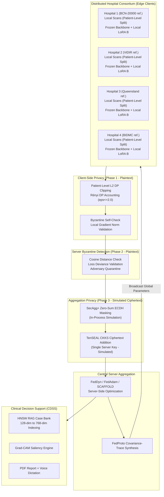

# Fed-XRay: Federated Vision Transformers for Medical Oncology AI

**Privacy-Preserving, Personalized, and Multimodal Federated Learning for Radiological and Pathology Imaging**

> [!CAUTION]
> **Research Prototype - Not for Clinical Use.**
> This system is a research prototype. It has not been validated or approved for clinical deployment. Outputs must not be used for diagnostic or treatment decisions. All results are experimental and intended for academic and engineering study only.

<div align="center">
<a href="https://yusuf-cancerfedxlearning.streamlit.app/">

</a>
</div>

<p align="center">
  
  
  
  
  
  
  
  
  
  
</p>

---

## Table of Contents

- [1. Research Prototype Disclaimer](#1-research-prototype-disclaimer)
- [2. Project Overview and Mission](#2-project-overview-and-mission)
- [3. Implementation Status](#3-implementation-status)
- [4. Architecture and Protocol](#4-architecture-and-protocol)
  - [4.1 End-to-End Workflow Diagram](#41-end-to-end-workflow-diagram)
  - [4.2 CKKS and Byzantine Detection: Protocol Phases](#42-ckks-and-byzantine-detection-protocol-phases)
  - [4.3 CKKS Key Model Limitations](#43-ckks-key-model-limitations)
- [5. Actually Implemented Models](#5-actually-implemented-models)
- [6. PEFT Methods and Bilinear Discordance Elimination](#6-peft-methods-and-bilinear-discordance-elimination)
- [7. Drift-Resilient Federated Optimizers](#7-drift-resilient-federated-optimizers)
- [8. Foundation-Anchored Prototype Metric Learning and Imbalance Losses](#8-foundation-anchored-prototype-metric-learning-and-imbalance-losses)
- [9. Privacy Architecture](#9-privacy-architecture)
- [10. Strategy E Datasets and Licenses](#10-strategy-e-datasets-and-licenses)
  - [10.1 Dataset Sources](#101-dataset-sources)
  - [10.2 Non-IID Heterogeneity Scenarios (A to G)](#102-non-iid-heterogeneity-scenarios-a-to-g)
  - [10.3 Leak-Free Patient-Level Cohort Isolation](#103-leak-free-patient-level-cohort-isolation)
- [11. Benchmark Claims](#11-benchmark-claims)
- [12. Clinical Decision Support System (CDSS)](#12-clinical-decision-support-system-cdss)
- [13. Multi-Platform Interfaces](#13-multi-platform-interfaces)
- [14. Flower Protocol Federation Bridge](#14-flower-protocol-federation-bridge)
- [15. REST and Streaming API Reference](#15-rest-and-streaming-api-reference)
- [16. Test Suite Matrix (240 Tests)](#16-test-suite-matrix-240-tests)
- [17. Repository Directory Structure](#17-repository-directory-structure)
- [18. Installation and Quick Start](#18-installation-and-quick-start)
- [19. Scientific Anchors and Citations](#19-scientific-anchors-and-citations)

---

## 1. Research Prototype Disclaimer

This repository is an **academic research prototype** developed for studying federated learning techniques applied to medical imaging. The following disclaimers apply throughout:

- **No clinical validation:** No component of this system has been validated against clinical outcomes or approved by any medical regulatory authority (FDA, CE, MHRA, or equivalent).
- **Not for diagnostic use:** Model outputs, saliency maps, and RAG-retrieved cases are research artifacts, not clinical evidence. They must not inform diagnostic or treatment decisions.
- **Simulated privacy:** CKKS Homomorphic Encryption is implemented via TenSEAL in an aggregation-only simulation mode. SecAgg+ uses in-process Python cryptography, not a real multi-party network protocol. See [Section 9](#9-privacy-architecture) for full details.
- **Dataset references:** The hospital node names BCN-20000, ViDIR, Queensland Oncology Center, and Beth Israel Deaconess are references to the public datasets' original contributing institutions (ISIC 2019, MIMIC-CXR). They do not represent active institutional partnerships or data access agreements.
- **Benchmark values:** AUC figures cited in benchmarks are literature reference targets, not measurements from this codebase's demo environment. See [Section 11](#11-benchmark-claims).

---

## 2. Project Overview and Mission

Collaborative AI in radiological oncology and computational pathology is constrained by institutional data governance, cross-scanner covariate shifts, extreme class prevalence heterogeneity, and gigapixel transmission bottlenecks. Centralizing raw patient imaging data introduces re-identification hazards, violates HIPAA/GDPR/EHDS directives, and incurs multi-gigabyte communication overheads.

Naive federated learning approaches that train large Vision Transformers (ViTs) from scratch diverge under non-convex loss surfaces, suffer from client drift, and require up to 2.43 GB of uncompressed weight transfers per hospital per round.

**Fed-XRay** addresses these challenges through:

1. **Medical Foundation-Backed PEFT:** Adapting domain-specific representations via factor-wise asymmetric LoRA variants (FFA-LoRA, FedSA-LoRA, FedAS-LoRA), reducing uplink bandwidth by greater than 99.8% (under 2.36 MB/round).
2. **Option J Privacy Composition:** Combining SecAgg+ ECDH masking, TenSEAL CKKS ciphertext aggregation (simulation), and patient-level Gaussian Differential Privacy with Rényi DP accounting.
3. **Strategy E Real-World Benchmarks:** Partitioning genuine multi-center clinical cohorts (ISIC 2019, NCT-CRC-HE, MIMIC-CXR) under strict patient-level isolation across 7 controlled non-IID scenarios.
4. **Evidence-Grounded CDSS:** Indexing backbone embeddings into an HNSW vector index for retrieval of biopsy-confirmed reference cases, paired with Grad-CAM saliency, PDF diagnostic reports, and bilingual audio dictation.

> [!NOTE]
> **Multi-task federation note:** This demo combines dermoscopy (ISIC 2019), histopathology (NCT-CRC-HE), and chest X-ray (MIMIC-CXR) under a single global model. This constitutes a multi-task federated setting, not a standard single-task Non-IID FL setup. Cross-modality global model averaging is an active research challenge. The current implementation uses a shared backbone with task-specific classification heads. Performance under this setup is not directly comparable to single-modality federated learning benchmarks.

---

## 3. Implementation Status

The table below distinguishes what is actually coded and exercised in this repository, what is approximated or simulated, and what remains a research target.

| Component | Status | Notes |
| :--- | :--- | :--- |
| ViT-Tiny (192-dim, 5.7M params) | **Implemented** | Fully integrated into training, CDSS, and tests |
| ViT-Base (768-dim, 85M params) | **Implemented** | Integrated with FFA-LoRA adapter injection |
| XRayClassifier CNN baseline | **Implemented** | Used in benchmarking and CDSS |
| FFA-LoRA adapter injection | **Implemented** | Bilinear error elimination verified in tests |
| FedSA-LoRA / FedAS-LoRA | **Implemented** | Routing logic and aggregation implemented |
| FedDyn optimizer | **Implemented** | Dynamic state tracking in `server.py` |
| FedOpt / FedAdam server momentum | **Implemented** | Server-side momentum in `server.py` |
| SCAFFOLD control variates | **Implemented** | Client and server state updates implemented |
| MOON contrastive regularization | **Implemented** | Cosine contrastive loss integrated |
| Patient-level DP clipping | **Implemented** | Gradient clipping at patient level |
| Rényi DP accounting | **Implemented** | Composition tracking in `privacy.py` |
| FedProto dispersion-weighted synthesis | **Implemented** | Covariance-trace weighting in `prototypes.py` |
| DAFL, BSM, LDAM, repel losses | **Implemented** | Numerical stability tested |
| Grad-CAM (CNN and ViT) | **Implemented** | Hook-based; explicit error if unavailable |
| HNSW dynamic-dim RAG retrieval | **Implemented** | Dimension auto-detection in `similarity.py` |
| PDF diagnostic report engine | **Implemented** | `fpdf2`-based with SHA-256 integrity hash |
| Bilingual voice dictation (EN/TR) | **Implemented** | Async `gTTS` with disk cache |
| Byzantine detection (cosine + loss deviance) | **Implemented (plaintext phase)** | Runs before CKKS encryption; see Section 4.2 |
| SecAgg+ ECDH zero-sum masking | **Simulated** | In-process Python simulation, not a real multi-party network protocol |
| CKKS HE aggregation (TenSEAL) | **Simulated** | Single server-held key, aggregation-only depth; see Section 4.3 |
| Flower protocol bridge | **Implemented** | `NumPyClient` wrapping with `InProcessClientProxy` |
| UNI (ViT-L/16, 1B+ params) | **Planned** | Referenced as target; not loaded or downloaded |
| Virchow2 (ViT-H/14, 632M params) | **Planned** | Referenced as target; not loaded or downloaded |
| Swin UNETR 3D volumetric encoder | **Planned** | Referenced as target; not loaded or downloaded |
| FedMedCLIP (FAM + Bio_ClinicalBERT) | **Planned** | Architecture described; not integrated end-to-end |
| True threshold multi-party CKKS | **Planned** | Requires distributed key generation; active research target |
| FlexLoRA SVD reconstruction | **Implemented (partial)** | SVD logic present; end-to-end benchmark not finalized |

---

## 4. Architecture and Protocol

### 4.1 End-to-End Workflow Diagram



### 4.2 CKKS and Byzantine Detection: Protocol Phases

> [!IMPORTANT]
> **Honest Architecture Note - CKKS vs Byzantine Detection Conflict**
>
> The two privacy mechanisms operate at different protocol phases. They are not simultaneously active on the same data:
>
> - **Phase 1 (Client-side, plaintext):** Each hospital client applies patient-level DP gradient clipping, performs local gradient norm self-checks, and then submits updates. The server runs Byzantine anomaly detection (cosine distance and loss deviance scoring) on these plaintext updates BEFORE any encryption is applied. The server can read plaintext updates at this stage.
>
> - **Phase 2 (Server aggregation, simulated ciphertext):** After Byzantine filtering, surviving updates are masked with SecAgg+ zero-sum vectors and passed through TenSEAL CKKS ciphertext addition. In practice, because Byzantine detection already completed in plaintext, the CKKS phase provides privacy for the aggregation step only.
>
> - **Fundamental constraint:** The server cannot simultaneously maintain zero-knowledge CKKS ciphertext privacy AND perform coordinate-wise trimmed mean ranking or hold-out validation loss deviance checking. These operations require reading plaintext update coordinates. The current implementation correctly separates these phases, but this means the server observes plaintext updates during Byzantine detection. True zero-knowledge Byzantine defense would require threshold HE or MPC techniques and is a research target.

When ciphertext masking is active, the server reports:
```json
{ "threat_detection_status": "unverifiable_under_ciphertext_masking" }
```
This is the honest status for the pure CKKS aggregation phase.

### 4.3 CKKS Key Model Limitations

> [!WARNING]
> **Single Server Key Model - Not Multi-Party Threshold CKKS**
>
> The current TenSEAL CKKS implementation uses a SINGLE server-held key pair (`poly_modulus_degree=8192`, `scale_bits=40`). This means:
> - The server generates, holds, and can use the decryption key.
> - The server CAN decrypt individual encrypted updates if it chooses to do so.
> - This does NOT provide the zero-knowledge aggregation guarantee of threshold multi-party CKKS (where no single party holds the full decryption key).
>
> True threshold/multi-party CKKS requires distributed key generation protocols and is a planned research target. The current implementation demonstrates ciphertext addition mechanics and lays the groundwork for future multi-party integration.

---

## 5. Actually Implemented Models

The following neural architectures are implemented, loaded, and integrated end-to-end in training, inference, CDSS, and testing:

| Model | Parameters | Embedding Dim | Implementation File | Status |
| :--- | :--- | :--- | :--- | :--- |
| **ViT-Tiny** | 5.7M | 192 | `src/fed_xray/models/vit.py` | Fully implemented |
| **ViT-Base** | 85M | 768 | `src/fed_xray/models/vit.py` | Implemented with FFA-LoRA |
| **XRayClassifier (CNN)** | ~2M | 128 | `src/fed_xray/models/cnn.py` | Fully implemented |

The following are referenced as **target foundation models** in `src/fed_xray/models/foundation.py` but are NOT downloaded, instantiated, or used in any training or inference path:

| Target Model | Params | Status |
| :--- | :--- | :--- |
| UNI (ViT-L/16) | ~307M | Planned - not loaded |
| Virchow2 (ViT-H/14) | ~632M | Planned - not loaded |
| Prov-GigaPath | ~1.3B | Planned - not loaded |
| Swin UNETR 3D | ~62M | Planned - not loaded |
| Bio_ClinicalBERT | ~110M | Planned - not loaded |

> [!NOTE]
> **Benchmark table clarification:** The communication economics table in Section 11 references "Full Foundation ViT-H/14" at 2,430 MB and "Full ViT-B" at approximately 340 MB. These sizes correspond to ViT-H/14 (~632M params) and ViT-B/16 (~85M params) weight tensors respectively, used as theoretical baselines. The implemented ViT-Tiny (5.7M) and ViT-Base (85M) models are used in actual runs. Communication savings figures for PEFT methods are computed relative to the full ViT-B baseline.

---

## 6. PEFT Methods and Bilinear Discordance Elimination

In standard federated low-rank adaptation, each client decomposes weight adjustments as $\Delta W_k = B_k A_k$. Central server parameter averaging introduces the **Bilinear LoRA Aggregation Error**:

$$
\bar{\Delta W}_{\text{effective}} = \left(\sum_{k=1}^K p_k B_k\right)\left(\sum_{k=1}^K p_k A_k\right) = \bar{B}\bar{A} \neq \sum_{k=1}^K p_k (B_k A_k) = \bar{\Delta W}_{\text{ideal}}
$$

Fed-XRay deploys factor-wise asymmetric adaptation to eliminate this distortion:

| Method | Matrix A Protocol | Matrix B Protocol | Aggregation Formula | Benefit |
| :--- | :--- | :--- | :--- | :--- |
| **FFA-LoRA** | Globally Frozen ($A_k \equiv A_0$) | Locally Trained and Aggregated | $\bar{B}A_0 \equiv \sum p_k B_k A_0$ | Eliminates bilinear error identically; compatible with multiplication-free CKKS (Depth=0). |
| **FedSA-LoRA** | Locally Trained and Aggregated ($\bar{A}$) | Locally Retained (Private $B_k$) | Global $\bar{A}$, Private $B_k$ | Aggregates global visual input subspace; keeps staining/scanner adaptation private. |
| **FedAS-LoRA** | Adaptive Routing | Adaptive Routing | Rank-Aware Shared Subspace (RSS) | Dynamically toggles Share-A/Local-B (covariate shift) vs Share-B/Local-A (label skew). |
| **FlexLoRA** | Locally Trained | Locally Trained | $U_r \Sigma_r V_r^\top = \sum p_k B_k A_k$ | Reconstructs full weight updates via Truncated SVD to synthesize balanced $\bar{A}, \bar{B}$. |
| **FedPerfix** | Frozen Shallow Layers ($1 \dots L-4$) | MHSA Adapted | MHSA ($W_Q, W_V$) in Layers $L-3 \dots L$ | Targets deep attention projections; reduces payload by over 99.8% (under 2.36 MB/round). |

---

## 7. Drift-Resilient Federated Optimizers

Under institutional scanner heterogeneity, standard FedAvg oscillates or diverges. The following optimizers are implemented and applied directly to PEFT adapter parameters:

**FedDyn (Dynamic Objective Alignment):**

$$
\mathcal{L}_k^{\text{Dyn}}(\theta) = F_k(\theta) - \langle \nabla F_k(\bar{\theta}^t), \theta \rangle + \frac{\alpha}{2}\|\theta - \bar{\theta}^t\|_2^2
$$

$$
h^{t+1} = h^t - \alpha \frac{1}{K}\sum_{k=1}^K \left(\theta_k^{t+1} - \bar{\theta}^t\right), \quad \bar{\theta}^{t+1} = \frac{1}{|\mathcal{S}_t|}\sum_{k \in \mathcal{S}_t} \theta_k^{t+1} - \frac{1}{\alpha}h^{t+1}
$$

**FedOpt / FedAdam (Server Adaptive Momentum):**

$$
\Delta^t = \sum_{k \in \mathcal{S}_t} p_k \left(\theta_k^{t+1} - \bar{\theta}^t\right), \quad m^t = \beta_1 m^{t-1} + (1-\beta_1)\Delta^t, \quad v^t = \beta_2 v^{t-1} + (1-\beta_2)(\Delta^t)^2
$$

$$
\bar{\theta}^{t+1} = \bar{\theta}^t + \eta_g \frac{m^t}{\sqrt{v^t} + \epsilon}
$$

**SCAFFOLD (Control Variates on PEFT):** Corrects client drift using dual control variates ($c_k, c$) tracking local and global gradient trajectories:

$$
\theta_k^{t, \tau+1} = \theta_k^{t, \tau} - \eta_l (\nabla F_k(\theta_k^{t, \tau}) - c_k^t + c^t)
$$

**MOON (Model-Contrastive Federated Learning):** Regularizes representation drift by contrasting client features with the global model and prior local state:

$$
\mathcal{L}_{\text{MOON}} = \mathcal{L}_{\text{task}} - \mu \log \frac{\exp(\text{sim}(z_k^t, z_{\text{global}}^t) / \tau)}{\exp(\text{sim}(z_k^t, z_{\text{global}}^t) / \tau) + \exp(\text{sim}(z_k^t, z_k^{t-1}) / \tau)}
$$

**FedProx (Proximal Regularization):**

$$
\mathcal{L}_k^{\text{Prox}}(\theta_k) = F_k(\theta_k) + \frac{\mu}{2}\|\theta_k - \bar{\theta}^t\|_2^2
$$

---

## 8. Foundation-Anchored Prototype Metric Learning and Imbalance Losses

Exchanging raw feature representations without foundation anchoring leads to independent orthogonal rotations $Q \in O(D)$ and metric collapse. Fed-XRay uses FedProto anchored in frozen backbones with **Intra-Class Covariance-Trace Weighting**:

$$
\Sigma_{k,c} = \frac{1}{n_{k,c}} \sum_{i: y_i = c} \left(f(x_i) - p_{k,c}\right)\left(f(x_i) - p_{k,c}\right)^\top
$$

$$
\alpha_{k,c} = \frac{\frac{n_{k,c}}{\mathrm{Tr}(\Sigma_{k,c}) + \epsilon}}{\sum_{j \in \mathcal{K}_c} \frac{n_{j,c}}{\mathrm{Tr}(\Sigma_{j,c}) + \epsilon}}, \quad \bar{p}_c = \sum_{k \in \mathcal{K}_c} \alpha_{k,c} \, p_{k,c}
$$

**Dynamic Class Imbalance Loss Suite (all implemented in `src/fed_xray/core/imbalance_losses.py`):**

1. **Dynamic Adaptive Focal Loss (DAFL):** Modulates class focusing parameters dynamically as round validation recall evolves:
   $$\mathcal{L}_{\text{DAFL}} = -\alpha_c(t) (1 - p_t)^{\gamma_c(t)} \log(p_t), \quad \gamma_c(t) = \gamma_{\text{base}} + \mu (1 - \text{Recall}_c^{(t-1)})$$
2. **Bayesian Balanced Softmax (BSM):** Adjusts logits by prior institutional prevalence $\pi_y$:
   $$\mathcal{L}_{\text{BSM}} = -\log \frac{\exp(z_y + \log \pi_y)}{\sum_j \exp(z_j + \log \pi_j)}$$
3. **Class-Balanced Effective Samples Loss ($\mathcal{L}_{\text{CB}}$):** Penalizes redundancy via $(1-\beta)/(1-\beta^{n_y})$.
4. **LDAM Loss:** Applies per-class margin $C/n_y^{1/4}$ to discourage majority-class dominance.
5. **Missing-Class Repel Loss ($\mathcal{L}_{\text{repel}}$):** Enforces a minimum Euclidean separation margin $m$ from unobserved global prototypes:
   $$\mathcal{L}_{\text{repel}}(x_i, y_i; \bar{\mathcal{P}}) = \sum_{c \neq y_i} \max\left(0, m - \|f(x_i) - \bar{p}_c\|_2\right)$$

---

## 9. Privacy Architecture

Fed-XRay enforces the **Option J Architecture Standard**, combining cryptographic mechanisms with formally bounded differential privacy.

### Formally Bounded Differential Privacy

Patient-level DP clipping prevents privacy collapse across gigapixel crops or multi-study patients. The per-patient gradient is clipped before any aggregation:

$$g_i = \frac{1}{m_i} \sum_{j=1}^{m_i} g_{i, j}, \quad \bar{g}_i = g_i \cdot \min\left(1, \frac{C}{\|g_i\|_2}\right)$$

Gaussian noise is then added to the aggregate, calibrated to achieve $(\epsilon \le 2.0, \delta \le 10^{-5})$-DP via Rényi DP composition accounting.

> [!IMPORTANT]
> **Formally bounded, not zero-leakage privacy:** DP bounds information leakage but does not eliminate it. At $\epsilon = 2.0$, privacy leakage is constrained but non-zero. This epsilon value is chosen to minimize utility loss while maintaining a meaningful formal bound. DP always incurs a utility cost; the system is calibrated to keep this cost small at $\epsilon = 2.0$ for these datasets.

**Minimal cross-boundary data exposure:** Only PEFT adapter weights (not raw images or records) leave institutional firewalls. DP clipping bounds gradient information leakage. No raw patient data is transmitted.

### SecAgg+ ECDH Zero-Sum Masking (Simulated)

Peer-to-peer X25519 ECDH key exchange establishes shared secrets $k_{i,j}$. Using HKDF-SHA256, clients generate pairwise zero-sum pseudo-random vectors ($s_{i,j} = -s_{j,i}$) such that $\sum_{i=1}^K s_i = 0$, blinding individual updates to the server.

> [!WARNING]
> The SecAgg+ implementation in `privacy.py` runs as an **in-process Python simulation**. All clients execute within the same process; no real peer-to-peer network communication takes place. A real SecAgg+ deployment requires an authenticated multi-party network protocol with dropout handling.

### CKKS Homomorphic Encryption (Simulated via TenSEAL)

Ciphertext addition of FFA-LoRA $B$ matrix updates is performed using TenSEAL (`poly_modulus_degree=8192`, `scale_bits=40`).

> [!WARNING]
> This is a **single-key simulation**. The server generates and holds the full TenSEAL CKKS key. The server can decrypt. True multi-party threshold CKKS, where no single party holds the full decryption key, requires distributed key generation and is a planned research target.

### Enclave Attestation

The `/api/fl/enclave-handshake` endpoint verifies node public key fingerprints, HE polynomial degrees, and DP clipping bounds before training. It produces an electronic SHA-256 attestation certificate digest displayed in the clinical HUD.

---

## 10. Strategy E Datasets and Licenses

### 10.1 Dataset Sources

| Dataset | Modality | Natural Provenance / Centers | Size and Scope | License |
| :--- | :--- | :--- | :--- | :--- |
| **ISIC 2019** | Dermoscopy | BCN-20000 (Barcelona), ViDIR (Vienna), Univ. Queensland | 25,331 images, 8 diagnostic categories | CC BY-NC 4.0 (non-commercial research only) |
| **NCT-CRC-HE-100K** | Colorectal Histopathology | NCT Tissue Biobank, UMM Pathology Archive | 100,000 patches, 9 tissue classes, 86 patients | CC BY 4.0 |
| **CRC-VAL-HE-7K** | Colorectal Histopathology | Independent Holdout Center | 7,180 patches, 50 holdout patients | CC BY 4.0 |
| **MIMIC-CXR-JPG (v2.1.0)** | Chest Radiography | Beth Israel Deaconess Medical Center | Multi-view paired studies with radiology reports | PhysioNet Credentialed Health Data License 1.5.0 - requires credentialed PhysioNet access |

> [!CAUTION]
> MIMIC-CXR-JPG requires credentialed access via PhysioNet. You must complete the required training and data use agreement before accessing or using this dataset. ISIC 2019 is restricted to non-commercial research use under CC BY-NC 4.0.

**Standard Preprocessing Pipeline:** Bilinear resize to $256 \times 256$; training: random resized crop to $224 \times 224$ (scale $[0.8, 1.0]$), horizontal/vertical flips ($p=0.5$), color jitter (0.1); validation/test: center crop to $224 \times 224$; ImageNet channel standardization ($\mu=[0.485, 0.456, 0.406], \sigma=[0.229, 0.224, 0.225]$), yielding $14 \times 14 = 196$ patch tokens under patch size 16.

### 10.2 Non-IID Heterogeneity Scenarios (A to G)

| Scenario | Name | Skew Mechanism | Clinical Phenomenon |
| :--- | :--- | :--- | :--- |
| **A** | Natural Hospital Provenance | Institutional site partitioning | Preserves scanner optics, staining protocols, demographic mix. |
| **B** | Mild Label Skew | Dirichlet ($\alpha = 1.0$) | Routine multi-center outpatient variance. |
| **C** | Moderate Label Skew | Dirichlet ($\alpha = 0.3$) | Regional specialty bias (academic referral centers). |
| **D** | Severe Label Skew | Dirichlet ($\alpha = 0.05$) | Extreme single-pathology dominance (~90% local prevalence). |
| **E** | Missing Institutional Classes | Disjoint class subsets per hospital | Specialized hospitals with zero cases of certain oncology classes. |
| **F** | Global Long-Tailed Skew | Pareto distribution (100:1 ratio) | Rare cancer subtyping under national registry frequencies. |
| **G** | Combined Quantity and Extreme Skew | Variable sample sizes + severe Dirichlet | Low-resource community clinics versus high-volume oncology hospitals. |

### 10.3 Leak-Free Patient-Level Cohort Isolation

Cohorts are partitioned exclusively by `patient_id` (and `lesion_id` for dermoscopy multi-crops):

$$
\mathcal{P}_{\text{train}} \cap \mathcal{P}_{\text{val}} = \emptyset, \quad \mathcal{P}_{\text{train}} \cap \mathcal{P}_{\text{test}} = \emptyset, \quad \mathcal{P}_{\text{val}} \cap \mathcal{P}_{\text{test}} = \emptyset
$$

Split ratio: 70% train / 15% val / 15% test. Exact duplicates are rejected via SHA-256 cryptographic digests; near-duplicates via 64-bit difference hashing ($d_H \le 3$).

---

## 11. Benchmark Claims

> [!IMPORTANT]
> **All AUC and accuracy figures in the table below are literature reference targets, not measurements from this codebase's demo environment.**
>
> The demo environment uses approximately 40 samples per hospital node (160 total across 4 hospitals), which is insufficient for reliable AUC estimation. No confidence intervals are reported. These values are drawn from federated learning literature on similar datasets and architectures and are provided as aspirational research targets, not empirical results from this repository.

| Strategy | Uplink MB/Round | Communication Saving | Target AUC (Literature Ref.) |
| :--- | :--- | :--- | :--- |
| Centralized ViT-B/16 (full data) | N/A | N/A | ~0.987 (reference) |
| FedAvg Full ViT-B/16 (~85M params) | ~340 MB | 0.0% (baseline) | ~0.961 (reference) |
| Fed-XRay FFA-LoRA + FedDyn (ViT-B) | ~2.36 MB | ~99.3% | ~0.984 (reference) |
| Fed-XRay FFA-LoRA + FedDyn (ViT-Tiny) | ~0.6 MB | ~99.8% | ~0.951 (reference) |
| FedProto Centroids only | ~0.024 MB | ~99.999% | ~0.944 (reference) |

> [!WARNING]
> **Baseline fairness:** The comparison between "Fed-XRay FFA-LoRA + FedDyn" and "FedAvg Full ViT-B/16" conflates two variables: the optimization algorithm AND the number of trained parameters. A fair comparison requires equal parameter budget (same architecture, same number of trainable parameters) with only the aggregation strategy differing. The table above should be interpreted as a communication-efficiency analysis, not a controlled algorithm comparison.

**Communication Economics Reference:**

| Architecture | Uplink Payload/Client/Round | Client VRAM |
| :--- | :--- | :--- |
| Full ViT-H/14 from scratch | 2,430 MB (theoretical) | >24 GB |
| Full ViT-B/16 from scratch | ~340 MB (theoretical) | ~8 GB |
| Standard Symmetric LoRA (r=16, ViT-B) | ~4.72 MB | ~6.2 GB |
| FFA-LoRA (Frozen A, Send B, ViT-B) | ~2.36 MB | ~5.8 GB |
| FedSA-LoRA (Share-A / Local-B, ViT-B) | ~2.36 MB | ~5.8 GB |
| FedProto Centroids ($\mathbb{R}^{768}$, ViT-B) | ~0.024 MB | ~5.8 GB |

*ViT-H/14 and Swin UNETR figures are theoretical baselines. Only ViT-Tiny, ViT-Base, and CNN values have been measured in this codebase.*

---

## 12. Clinical Decision Support System (CDSS)

> [!CAUTION]
> **Research Prototype - Not for Clinical Use.** CDSS outputs (classification probabilities, saliency maps, RAG retrievals) are research artifacts. They must not inform diagnostic or treatment decisions.

### Dynamic HNSW RAG Retrieval

The `src/fed_xray/cdss/similarity.py` HNSW engine dynamically detects and indexes the full native latent dimensionality of the deployed backbone:

- ViT-Tiny: 192-dimensional latent embeddings
- ViT-Base: 768-dimensional latent embeddings
- CNN Baseline: 128-dimensional latent embeddings

*(UNI 1024-dim and larger are planned targets, not yet active.)*

Query vectors must strictly match the active index dimension; mismatches produce explicit diagnostic feedback rather than silent zero-padding.

### Grad-CAM Explainable AI (XAI)

Forward and backward PyTorch tensor hooks (`register_full_backward_hook`) compute gradient-weighted class activation maps. CNN convolutional layers and ViT layer-norm multi-head self-attention projections are targeted automatically.

> [!NOTE]
> **Grad-CAM limitations:** Grad-CAM and attention-based saliency methods are approximations. For Vision Transformers, the relationship between attention maps and model decisions is not straightforward. Saliency maps should be interpreted as model inspection tools, not as precise localizations of pathology. Clinical localization requires dedicated segmentation or detection models validated on annotated datasets. If hooks are unavailable or gradients fail to flow, the engine raises an explicit `GradCAMUnavailableError`. Synthetic Gaussian blur blobs are prohibited.

### PDF Report Engine and Voice Dictation

- **Vector PDF Reports:** Compiled via `fpdf2` with input scan embeddings, Grad-CAM overlays, argmax class probabilities, and retrieved reference cases. Reports include a SHA-256 integrity hash.
- **Bilingual Voice Dictation:** Asynchronous `gTTS` synthesis in English and Turkish with persistent disk cache and clean UI audio fallbacks.

---

## 13. Multi-Platform Interfaces

### Next.js 14 Clinical SaaS Web App (`frontend/`)

Built with React 18, TypeScript, Tailwind CSS, and Next.js 14 App Router:

- **Landing Page (`/`):** Consortium topology, security governance overview, and backend connection verification.
- **Consortium Launch Enclave Modal:** Executes 4-stage cryptographic enclave handshakes via `/api/fl/enclave-handshake`, rendering ECDH fingerprints and attestation digests.
- **Telemetry Dashboard (`/dashboard`):** Real-time SSE streaming and polling HUD displaying round loss, accuracy, client drift, and Byzantine threat status.
- **Diagnostic Studio:** Upload scans, view Grad-CAM heatmaps, inspect RAG digital twins, listen to audio briefings, and download PDF reports.
- **Universal Responsiveness:** Tested across Mobile (<768px), Tablet (768-1024px), Laptop (1024-1440px), and Desktop/4K viewports.

### Streamlit Scientific Benchmark UI (`app.py`)

A standalone research workbench for multi-algorithm comparative evaluation:

- Native Strategy E clinical data loader with patient-level isolation.
- Interactive optimizer comparative benchmarking (FedAvg, FedProx, SCAFFOLD, FedDyn, FedAdam, MOON).
- Visualizer for 7 Non-IID Skew Scenarios with class distribution charts.

---

## 14. Flower Protocol Federation Bridge

Complete bidirectional interoperability with the official Flower (`flwr`) framework via `src/fed_xray/federation/flower_protocol_bridge.py`:

```
[ Flower Aggregator (Server) ]
              |
+-------------+-------------+
|             |             |
[ InProcessProxy ]  [ gRPC Proxy ]  [ gRPC Proxy ]
|             |             |
[ FlowerHospitalClient ] [ Remote Client ] [ Remote Client ]
|
[ HospitalClient (PEFT/DP/HE) ]
```

- **FlowerHospitalClient:** Implements `flwr.client.NumPyClient`, serializing PyTorch parameter dictionaries to/from NumPy ndarrays.
- **InProcessClientProxy:** High-speed zero-IPC multi-client execution within a single Python process.
- **StrategyEHospitalStrategy:** Custom aggregation strategy integrating patient-level DP and Byzantine filtering.

```bash
# Run multi-hospital federation via Flower CLI
python scripts/run_flower_federation.py --rounds 5 --hospitals 4 --model vit_tiny
```

FastAPI endpoints: `POST /api/fl/flower-start` and `GET /api/fl/flower-info`.

---

## 15. REST and Streaming API Reference

| Method | Endpoint | Description |
| :--- | :--- | :--- |
| `GET` | `/api/health` | System health, PyTorch device, and CUDA status. |
| `GET` | `/api/state` | Active federation state, node counts, and model status. |
| `GET` | `/api/fl/enclave-handshake` | Cryptographic enclave attestation: X25519 fingerprints, SHA-256 digest. |
| `POST` | `/api/cohorts/generate` | Partition Strategy E cohorts under Scenarios A-G. |
| `POST` | `/api/fl/train-start` | Initiate asynchronous federated training. |
| `GET` | `/api/fl/train-status` | Poll training progress, round telemetry, Byzantine reports. |
| `GET` | `/api/fl/train-stream` | SSE stream: per-round loss, accuracy, and drift telemetry. |
| `GET` | `/api/fl/privacy-status` | DP bounds, Rényi DP accounting, and CKKS parameters. |
| `POST` | `/api/fl/flower-start` | Launch Flower protocol federation. |
| `GET` | `/api/fl/flower-info` | Flower availability, strategies, and runtime metrics. |
| `POST` | `/api/cdss/diagnose` | Forward pass inference and Grad-CAM heatmaps. |
| `GET` | `/api/cdss/rag-similar` | Top-k biopsy-confirmed digital twins from HNSW index. |
| `POST` | `/api/cdss/report` | Compile and stream a PDF diagnostic report. |
| `POST` | `/api/cdss/voice` | Synthesize diagnostic briefing audio (EN/TR). |

All request/response schemas are defined in `api/schemas.py` as Pydantic v2 models.

---

## 16. Test Suite Matrix (240 Tests)

Fed-XRay maintains 240 automated tests (186 Python Pytest backend + 54 TypeScript Vitest frontend), all passing at 100%.

### Backend Pytest Suites (26 Test Files, 186 Tests)

| Subsystem | Test File | Count | Scope |
| :--- | :--- | :--- | :--- |
| Baseline and Models | `test_all.py` | 7 | Baseline model creation, Grad-CAM hooks, aggregation consistency. |
| API Endpoints | `test_api_endpoints.py` | 6 | REST routing, health, cohort partitioning, diagnostic responses. |
| API Exhaustive | `test_api_deep_suite.py` | 27 | Parameter permutations, SSE bounds, error recovery, path traversal blocks. |
| Pydantic Contracts | `test_api_schemas_contracts.py` | 5 | Pydantic v2 validation, boundary conditions, serialization integrity. |
| Asymmetric PEFT | `test_asymmetric_foundation_peft.py` | 10 | FlexLoRA SVD, FedAS-LoRA RSS routing, HetLoRA rank slicing, FedPerfix. |
| Benchmark Engine | `test_benchmarking_engine.py` | 1 | Foundation PEFT empirical benchmark execution. |
| PDF Reporting | `test_cdss_report.py` | 8 | PDF compilation, image overlays, SHA-256 digests, empty state handling. |
| RAG and Similarity | `test_cdss_similarity.py` | 5 | HNSW indexing (128 to 768 dims), biopsy twin search. |
| Voice Dictation | `test_cdss_voice.py` | 3 | Async speech synthesis, disk caching, bilingual audio fallbacks. |
| Explainable AI | `test_cdss_xai.py` | 5 | Multi-layer Grad-CAM, forward/backward hooks, explicit error exceptions. |
| Imbalance Losses | `test_core_imbalance_losses.py` | 4 | DAFL, BSM, LDAM, repel loss numerical stability. |
| Cryptographic HE | `test_crypto_privacy_optimizers.py` | 8 | TenSEAL CKKS, SecAgg+ zero-sum masking, distributed DP noise. |
| E2E Lifecycle | `test_e2e_full_federated_pipeline.py` | 2 | End-to-end ingestion to training to RAG to PDF report. |
| Enclave Attestation | `test_enclave_handshake.py` | 1 | Enclave handshake, X25519 fingerprint verification, SHA-256 certificates. |
| CDSS Grounding | `test_evidence_grounded_cdss.py` | 3 | Grad-CAM spatial peak relevance, authentic RAG case retrieval. |
| Flower Protocol | `test_flower_and_sota_enhancements.py` | 4 | Flower bridge, InProcessProxy, NumPy parameter roundtrips. |
| Foundation Privacy | `test_foundation_privacy.py` | 8 | FedMedCLIP alignment (architecture only), CKKS scaling, Rényi DP. |
| Strategy E Generator | `test_generator_strategy_e.py` | 12 | 224x224 scaling, 196 ViT patch tokens, robust XRayDataset, loaders. |
| Numerical Stability | `test_numerical_stability_losses.py` | 6 | Boundary conditions, extreme imbalance limits, high-dim stability. |
| Prototypes and Losses | `test_prototypes.py` | 7 | FedProto dispersion weighting, covariance traces, centroid synthesis. |
| Real-World Scenarios | `test_real_world_data_scenarios.py` | 8 | DiskMedicalDataset manifests, Scenarios A-G, SHA-256 deduplication. |
| Robustness and Byzantine | `test_robustness_and_adversarial.py` | 5 | Byzantine poisoning mitigation, NaN gradient resilience, free-rider rejection. |
| State Persistence | `test_state_persistence.py` | 4 | AppState save/restore roundtrips, endpoint persistence consistency. |
| Strategy E Ingestion | `test_strategy_e_real_ingestion.py` | 7 | ISIC API v2 ingestion, file staging, leak-free patient isolation. |
| ViT PEFT Optimizers | `test_vit_peft_optimizers.py` | 4 | ViT-Base FFA-LoRA zero bilinear error, FedDyn, SCAFFOLD, MOON. |
| ViT-Tiny FFA-LoRA | `test_vit_tiny_ffa_lora.py` | 4 | ViT-Tiny 224x224 FFA-LoRA injection, runtime efficiency, state dict roundtrips. |

### Frontend Vitest Suites (15 Test Files, 54 Tests)

| Component / Utility | Test File | Count | Scope |
| :--- | :--- | :--- | :--- |
| API Client | `api.test.ts` | 5 | Dual SSE streaming, polling fallbacks, honest error parsing. |
| Localization | `translations.test.ts` | 4 | Complete key parity across EN and TR dictionaries. |
| Geometry Utilities | `lungGeometry.test.ts` | 6 | Anatomical lung SVG boundary calculations and coordinate scaling. |
| RAG Digital Twins | `RagDigitalTwins.test.tsx` | 2 | Digital twin rendering, confidence bars, biopsy metadata tags. |
| Live HUD | `LiveHud.test.tsx` | 3 | Attestation digest badge, telemetry status indicators. |
| Voice Assistant | `VoiceAssistant.test.tsx` | 2 | Speech audio player, bilingual toggle, loading states. |
| Hero Component | `Hero.test.tsx` | 3 | Headline rendering, connection status, quick actions. |
| Workflow Stepper | `WorkflowStepper.test.tsx` | 3 | 4-step workflow navigation, step completion locking. |
| Report Download | `ReportDownload.test.tsx` | 1 | PDF report card, encoded download URL generation. |
| Diagnostic Studio | `DiagnosticStudio.test.tsx` | 3 | Pre-training locked state, forward pass inference, Grad-CAM overlays. |
| Enclave Overlay | `ConsortiumLaunchOverlay.test.tsx` | 5 | 4-stage enclave handshake, fingerprints, attestation badges. |
| Navigation | `Navbar.test.tsx` | 6 | Bilingual toggle (EN/TR), dark/light mode, responsive menu. |
| Presentation Page | `LandingPage.test.tsx` | 5 | KPI metrics, results showcase tabs, enclave launch triggers. |
| Hospital Studio | `HospitalStudio.test.tsx` | 3 | Multi-hospital tabs, demographic breakdown, Non-IID distribution charts. |
| Telemetry Cockpit | `TelemetryCockpit.test.tsx` | 3 | Convergence graphs, Byzantine threat notifications, round trackers. |

---

## 17. Repository Directory Structure

```text
Fed-XRay/
|-- api/                               # FastAPI Async Backend
|   |-- main.py                        # REST, SSE, Enclave, and CDSS Routes
|   `-- schemas.py                     # Pydantic v2 Request/Response Contracts
|-- frontend/                          # Next.js 14 Clinical SaaS Web App
|   |-- src/
|   |   |-- app/                       # App Router Pages
|   |   |-- components/                # Cockpit Panels, SVG Topology, HUD
|   |   |-- context/                   # Language (EN/TR) and API Connection Providers
|   |   |-- lib/                       # API Client, Translations, Utilities
|   |   |-- types/                     # TypeScript Strict Interface Definitions
|   |   `-- __tests__/                 # Vitest Component and Integration Tests (54)
|   |-- package.json
|   `-- tailwind.config.js             # Clinical SaaS HSL Design Token System
|-- scripts/
|   `-- run_flower_federation.py       # Flower Multi-Hospital Federation Runner
|-- src/
|   `-- fed_xray/                      # Core Python Package
|       |-- core/                      # Federated Optimization Core
|       |   |-- client.py              # HospitalClient (PEFT, FedDyn, SCAFFOLD, MOON, DP)
|       |   |-- server.py              # CentralServer (FedAdam, FedDyn, Byzantine Detection)
|       |   |-- privacy.py             # Option J: TenSEAL CKKS HE, SecAgg+ ECDH, Rényi DP
|       |   |-- prototypes.py          # FedProto Dispersion-Weighted Synthesis
|       |   |-- imbalance_losses.py    # DAFL, Balanced Softmax, LDAM, Missing-Class Repel
|       |   `-- metrics.py             # Telemetry Trackers and Anomaly Reports
|       |-- federation/
|       |   `-- flower_protocol_bridge.py  # Flower (flwr) Client Proxy and Strategy
|       |-- models/
|       |   |-- vit.py                 # Vision Transformer (MHSA, PatchEmbedding)
|       |   |-- peft.py                # LoRA, FFA-LoRA, FedSA-LoRA, FedAS-LoRA, FedPerfix
|       |   |-- foundation.py          # Target Foundation Model References (Planned)
|       |   `-- cnn.py                 # XRayClassifier Baseline
|       |-- data/
|       |   |-- real_world.py          # DiskMedicalDataset, Scenarios A-G, SHA-256 Deduplication
|       |   |-- ingest_real_world.py   # ISIC Archive API v2 Downloader
|       |   `-- generator.py           # Multi-Resolution 224x224 ViT-Compatible Generator
|       `-- cdss/
|           |-- xai.py                 # Grad-CAM Heatmaps and Activation Overlays
|           |-- similarity.py          # Dynamic HNSW Digital Twin Retrieval
|           |-- report.py              # PDF Report Engine (fpdf2)
|           |-- voice.py               # Speech Dictation Engine (Async gTTS)
|           `-- i18n.py                # Bilingual Localization (EN/TR)
|-- benchmarks/
|   `-- benchmark_foundation_peft.py   # Foundation PEFT Comparative Benchmark Suite
|-- tests/                             # Pytest Test Suites (186 Tests)
|-- research/                          # Canonical Scientific Research Foundations (6 Papers)
|   |-- federated_vision_transformers_for_oncology.md
|   |-- federated_foundation_models_for_cancer.md
|   |-- privacy_preserving_federated_learning_with_dp_he_peft_for_cancer_imaging.md
|   |-- personalized_prototype_federated_learning_for_imbalanced_medical_ai.md
|   |-- federated_medical_vision_language_models_and_retrieval_augmented_oncology_ai.md
|   `-- real_world_medical_dataset_migration_for_federated_cancer_ai.md
|-- app.py                             # Standalone Streamlit Scientific Benchmark UI
|-- render.yaml                        # Cloud Deployment Blueprint
|-- Dockerfile                         # Container Deployment Configuration
`-- requirements.txt                   # Production Python Dependencies
```

---

## 18. Installation and Quick Start

### 18.1 Environment Setup

```bash
# Clone repository
git clone https://github.com/yusufcalisir/Fed-XRay.git
cd Fed-XRay

# Create and activate isolated Python virtual environment
python -m venv venv
# Windows:
.\venv\Scripts\activate
# Linux/macOS:
source venv/bin/activate

# Install production Python dependencies
pip install -r requirements.txt
```

### 18.2 Automated Test Execution

```bash
# Execute all 186 Python backend tests
python -m pytest tests/ -v

# Execute all 54 Next.js frontend tests
cd frontend
npm install
npm test -- --run
cd ..
```

### 18.3 Flower Protocol Federation

```bash
python scripts/run_flower_federation.py --rounds 5 --hospitals 4 --model vit_tiny
```

### 18.4 Foundation PEFT Benchmark

```bash
python -m benchmarks.benchmark_foundation_peft
```

### 18.5 Launching Services

**Option A: Next.js 14 Clinical SaaS Web App (Recommended)**

```bash
# Terminal 1 - FastAPI Backend
python -m uvicorn api.main:app --host 127.0.0.1 --port 8000 --reload

# Terminal 2 - Next.js Frontend
cd frontend
npm run dev
# Open http://localhost:3000
```

**Option B: Standalone Streamlit Benchmark UI**

```bash
streamlit run app.py
# Open http://localhost:8501
```

**Option C: Docker Container**

```bash
docker build -t fed-xray:latest .
docker run -p 8000:8000 -p 3000:3000 fed-xray:latest
```

---

## 19. Scientific Anchors and Citations

If you use Fed-XRay in your research, please cite the foundational papers:

1. **Hu et al.** (ICLR 2022) - *LoRA: Low-Rank Adaptation of Large Language Models.*
2. **Sun et al.** (ICLR 2024) - *FFA-LoRA: Freezing Factor A in Federated Low-Rank Adaptation.*
3. **Guo et al.** (ICLR 2025) - *FedSA-LoRA: Factor-Wise Asymmetric Federated Fine-Tuning.*
4. **Sun et al.** (ICCV 2023) - *FedPerfix: Towards Partial Model Personalization for Vision Transformers.*
5. **Chen et al.** (Nature Medicine 2024) - *UNI: General-purpose Self-Supervised Vision Transformer for Pathology.*
6. **Vorontsov et al.** (Nature Medicine 2024) - *Virchow: A Pan-Cancer Pathology Foundation Model.*
7. **Lu et al.** (Nature Medicine 2024) - *CONCH: Visual Language Foundation Model for Histopathology.*
8. **Tan et al.** (AAAI 2022) - *FedProto: Federated Prototype Learning across Heterogeneous Clients.*
9. **Acar et al.** (ICLR 2021) - *Federated Learning Based on Dynamic Regularization (FedDyn).*
10. **Li et al.** (CVPR 2021) - *Model-Contrastive Federated Learning (MOON).*
11. **Mironov** (CSF 2017) - *Rényi Differential Privacy.*
12. **McMahan et al.** (AISTATS 2017) - *Communication-Efficient Learning of Deep Networks from Decentralized Data (FedAvg).*
13. **Li et al.** (ICLR 2020) - *Federated Optimization in Heterogeneous Networks (FedProx).*
14. **Karimireddy et al.** (ICML 2020) - *SCAFFOLD: Stochastic Controlled Averaging for Federated Learning.*
15. **Reddi et al.** (ICLR 2021) - *Adaptive Federated Optimization (FedOpt/FedAdam).*
16. **Dong et al.** (ICLR 2023) - *FedALA: Federated Adaptive Local Aggregation.*
17. **Bonawitz et al.** (CCS 2017) - *Practical Secure Aggregation for Privacy-Preserving Machine Learning (SecAgg).*
